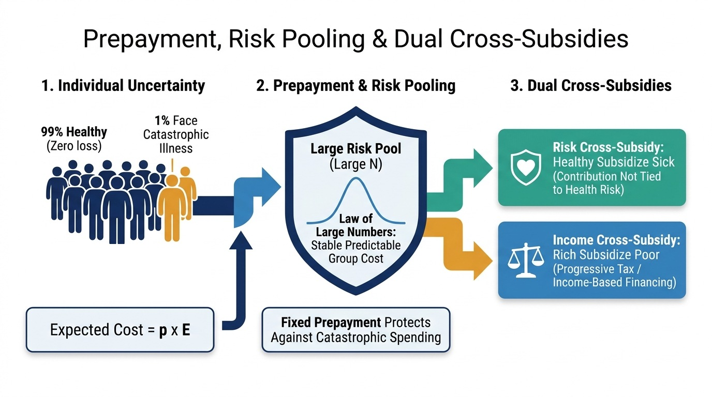
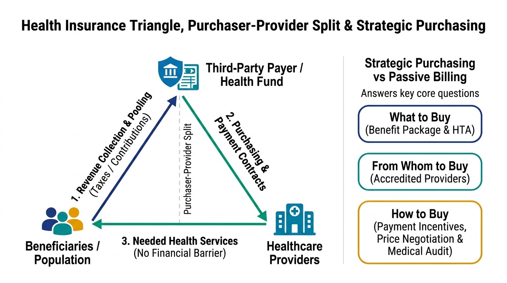
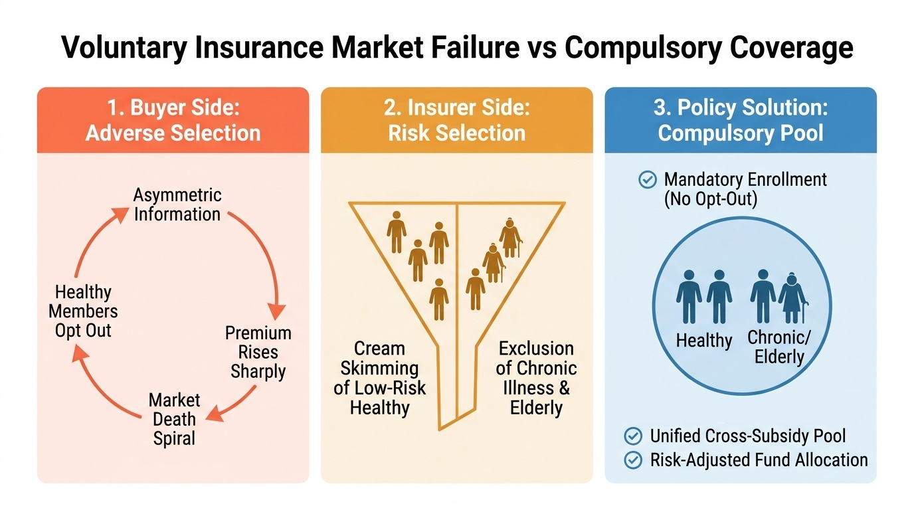
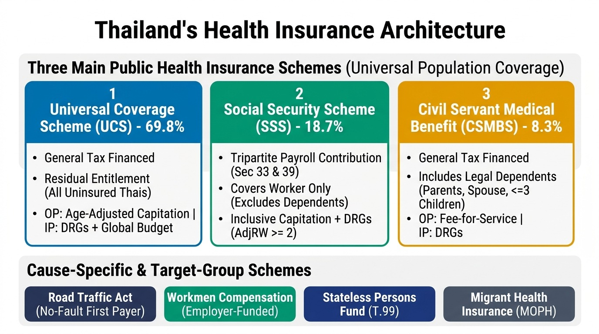
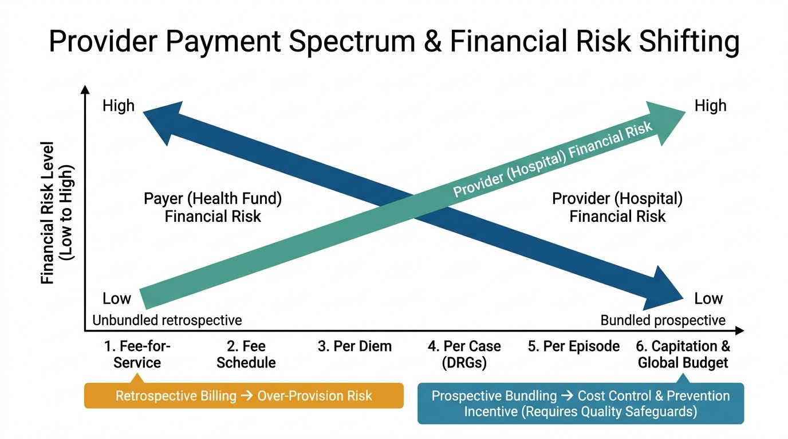
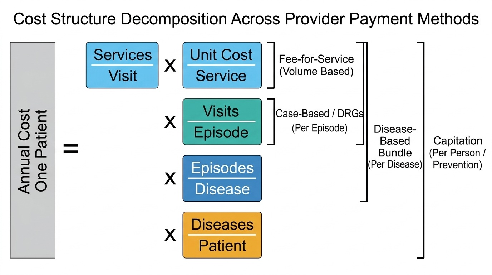
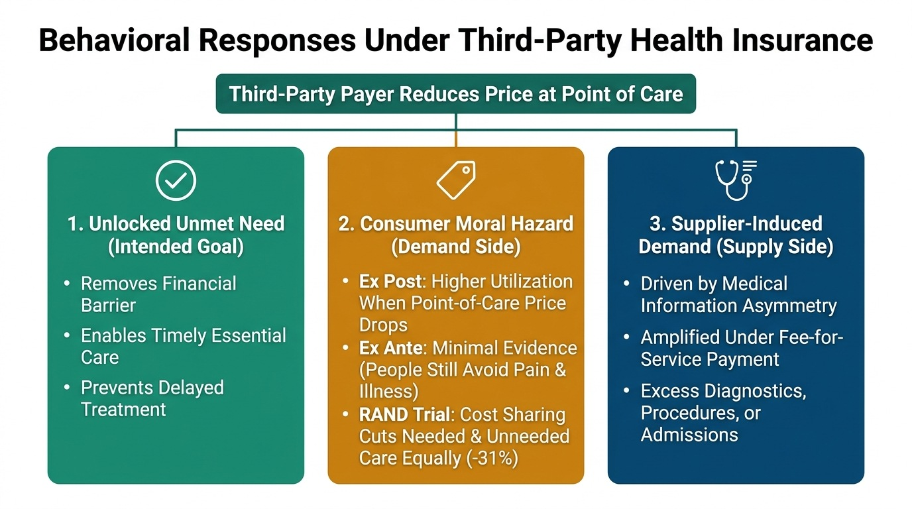
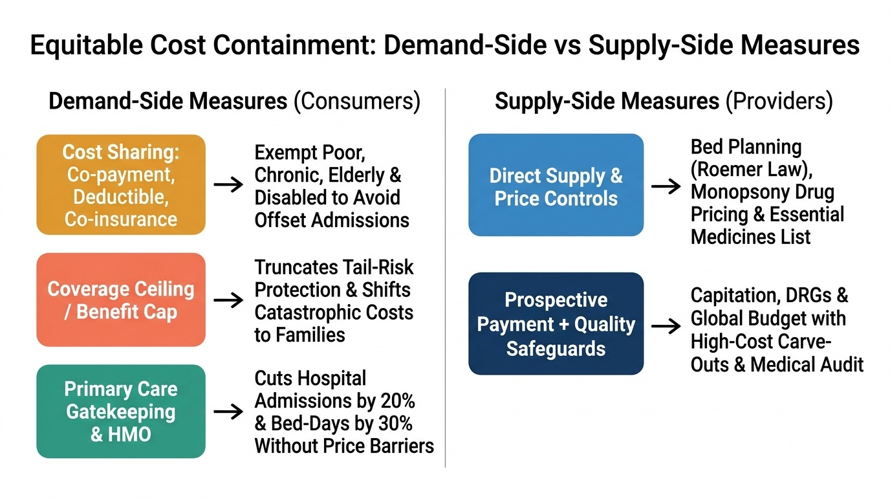

# HS6: การประกันสุขภาพ (Health Insurance)

สัมฤทธิ์ ศรีธำรงสวัสดิ์

## วัตถุประสงค์การเรียนรู้และคำถามนำ

| วัตถุประสงค์การเรียนรู้ | คำถามนำและโครงสร้างเนื้อหา |
|---|---|
| 1. **หลักการของการประกันสุขภาพ (principles of health insurance)** อธิบายการจ่ายเงินล่วงหน้าและการรวมกองทุนตามกฎของจำนวนมาก วิเคราะห์เกณฑ์รับประกันได้ 5 ข้อ หน้าที่หลักประกันสุขภาพ และการเฉลี่ยความเสี่ยงเทียบกับการเกลี่ยรายได้ | **1. เหตุใดการรวมคนจำนวนมากไว้ในกองทุนเดียวจึงทำให้ค่ารักษาที่คาดการณ์ไม่ได้ระดับบุคคลกลายเป็นสิ่งที่คาดการณ์และแบ่งเบาร่วมกันได้ (Why does pooling make unpredictable individual illness costs predictable and shareable?)** — กฎของจำนวนมาก (1.1) เกณฑ์รับประกันได้ (1.2) การป้องกัน CHE (1.3) และการอุดหนุนข้ามกลุ่ม (1.4) |
| 2. **องค์ประกอบของการประกันสุขภาพ (components of health insurance)** อธิบายบทบาทบุคคลที่สาม การแยกผู้ซื้อออกจากผู้ให้บริการ การบริหารกองทุน และการซื้อบริการเชิงกลยุทธ์ | **2. เมื่อเปลี่ยนจากการจ่ายเงินเองเป็นประกันสุขภาพ มีฝ่ายใดเพิ่มขึ้นและทำหน้าที่กำกับระบบอย่างไร (Which party is added, and what functions does it perform?)** — บุคคลที่สามและการแยกบทบาท (2.1) และการซื้อบริการเชิงกลยุทธ์ (2.2) |
| 3. **ประเภทของการประกันสุขภาพในประเทศไทย (types of health insurance in Thailand)** วิเคราะห์ความล้มเหลวของตลาดสมัครใจ และเปรียบเทียบระบบประกันสุขภาพภาคบังคับและระบบเสริมในไทย | **3. เหตุใดประกันภาคสมัครใจจึงไม่คุ้มครองทุกคน และระบบประกันสุขภาพไทยต่างกันอย่างไร (Why is voluntary insurance insufficient, and how do Thai schemes differ?)** — วงจรขาลงและการคัดความเสี่ยง (3.1) และสถาปัตยกรรมระบบไทย (3.2) |
| 4. **วิธีจ่ายเงินแก่ผู้ให้บริการ (provider payment methods)** เปรียบเทียบลูกโซ่โครงสร้างต้นทุน การกระจายความเสี่ยงทางการเงิน และแรงจูงใจของวิธีจ่ายเงินแต่ละแบบ | **4. วิธีจ่ายเงินแต่ละแบบให้ฝ่ายใดรับความเสี่ยงทางการเงิน และเปลี่ยนพฤติกรรมหน่วยบริการอย่างไร (Who bears financial risk, and how does it shape provider behavior?)** — FFS (4.1) เหมาจ่ายรายหัว (4.2) DRGs (4.3) งบยอดรวม (4.4) และการจ่ายแบบผสม (4.5) |
| 5. **พฤติกรรมเมื่อมีผู้จ่ายแทนและการควบคุมค่าใช้จ่าย (moral hazard and cost containment)** แยกความจำเป็นที่ปลดล็อกออกจาก moral hazard และ SID พร้อมประเมินมาตรการควบคุมต้นทุนที่เป็นธรรม | **5. เมื่อมีบุคคลที่สามเป็นผู้จ่าย พฤติกรรมผู้ป่วยและแพทย์เปลี่ยนอย่างไร และควบคุมต้นทุนอย่างไรโดยไม่สกัดกั้นบริการที่จำเป็น (How does third-party payment alter behavior, and how can costs be contained equitably?)** — Moral hazard กับ SID (5.1) มาตรการฝั่งผู้ป่วย (5.2) และฝั่งผู้ให้บริการ (5.3) |

## 1. การประกันสุขภาพเปลี่ยนความเสี่ยงที่คาดการณ์ไม่ได้ของแต่ละคนให้เป็นค่าใช้จ่ายที่คาดการณ์ได้ของกลุ่มผ่านการจ่ายเงินล่วงหน้าและการรวมกองทุน (Principles of Health Insurance)

ความจำเป็นในการรักษาพยาบาลเกิดขึ้นอย่างไม่แน่นอนระดับบุคคล ([Arrow, 1963](https://www.aeaweb.org/aer/top20/53.5.941-973.pdf)) การพึ่งพาเงินสด ณ จุดบริการ (out-of-pocket payment) จึงเสี่ยงทำให้ผู้ป่วยละทิ้งการรักษาหรือล้มละลาย ระบบการจ่ายเงินล่วงหน้าและการรวมกองทุน (prepayment and pooling) จึงเป็นรากฐานของหลักประกันสุขภาพถ้วนหน้า ([WHO, 2010](https://iris.who.int/handle/10665/44371); [Kutzin, 2013](https://doi.org/10.2471/BLT.12.113985); [Tangcharoensathien et al., 2018](https://doi.org/10.1016/S0140-6736%2818%2930198-3)) โดยเชื่อมโยงกฎของจำนวนมาก (1.1) เกณฑ์รับประกันได้ (1.2) การคุ้มครองครัวเรือน (1.3) และการอุดหนุนข้ามกลุ่ม (1.4)

### 1.1 ผู้ซื้อประกันสุขภาพจ่ายเบี้ยล่วงหน้าเพื่อแลกกับความแน่นอนและโอกาสเข้าถึงการรักษา โดยอาศัยกฎของจำนวนมากทำให้รายจ่ายของกลุ่มคาดการณ์ได้ (Uncertainty, Risk Aversion, and the Law of Large Numbers)

> สมมติว่าผู้เรียนแต่ละคนมีโอกาสร้อยละ 1 ต่อปีที่จะป่วยหนักจนเสียค่ารักษา 100,000 บาท หากเลือกได้ระหว่างเก็บเงินไว้เสี่ยงจ่ายเองกับลงขันปีละ 1,000 บาทเข้ากองทุนรวมของคน 100,000 คน ผู้เรียนจะเลือกทางใด และหากกองทุนมีสมาชิกเพียง 10 คน กองทุนจะเผชิญปัญหาใด

**การประกันสุขภาพ (health insurance)** หมายถึงกลไกทางการคลังที่ผู้เข้าร่วมจ่ายเงินจำนวนแน่นอนไว้ล่วงหน้า (fixed prepayment) เพื่อโอนความเสี่ยงของค่ารักษาพยาบาลที่ไม่แน่นอนในอนาคตไปให้กองทุนรวมรับแทน (risk transfer) แรงจูงใจสำคัญของผู้ซื้อประกันมีสองด้าน ด้านแรกคือการซื้อ **ความแน่นอนทางการเงิน (financial certainty)** ตามธรรมชาติของ **ผู้ไม่ชอบความเสี่ยง (risk-averse individual)** ซึ่งยินดีจ่ายเงินก้อนเล็กที่รู้จำนวนแน่นอนดีกว่าเสี่ยงเผชิญรายจ่ายก้อนใหญ่ที่ทำลายเสถียรภาพชีวิต ([Arrow, 1963](https://www.aeaweb.org/aer/top20/53.5.941-973.pdf)) ด้านที่สองคือ **แรงจูงใจเพื่อเข้าถึงการรักษาราคาแพง (access motive)** ที่ลำพังเงินออมของครัวเรือนไม่อาจซื้อไหว ([Nyman, 1999](https://doi.org/10.1016/S0167-6296%2898%2900049-6)) โดยเฉพาะเมื่อรายจ่ายสุขภาพของสังคมกระจุกตัวสูงมาก ดังข้อมูลสหรัฐอเมริกาที่พบว่าประชากรที่ป่วยหนักเพียงร้อยละ 5 ใช้รายจ่ายสุขภาพเกินครึ่งหนึ่งของทั้งประเทศ ([Berk & Monheit, 2001](https://doi.org/10.1377/hlthaff.20.2.9))

**กฎของจำนวนมาก (law of large numbers)** หมายถึงหลักความน่าจะเป็นที่ระบุว่าเมื่อรวมสมาชิกซึ่งมีความเสี่ยงเป็นอิสระต่อกันไว้ในกองทุนจำนวนมากพอ (n มีค่าสูง) ความแปรปรวนของสัดส่วนผู้ป่วยจริงรอบค่าคาดหมายทางสถิติจะแคบลงจนกองทุนคาดการณ์รายจ่ายเฉลี่ยต่อคนได้อย่างแม่นยำ ([Arrow, 1963](https://www.aeaweb.org/aer/top20/53.5.941-973.pdf); [Smith & Witter, 2004](https://documents1.worldbank.org/curated/en/642661468780615380/pdf/315950HNP0Chap1tterRiskPoolingFinal.pdf); [Biener & Eling, 2012](https://doi.org/10.1057/gpp.2011.29)) ในสถานการณ์ที่มีโอกาสป่วยร้อยละ 1 และค่ารักษา 100,000 บาท ค่าคาดหมายทางสถิติคือ 1,000 บาทต่อคน (0.01 × 100,000) กองทุนที่มีสมาชิกเพียง 10 คน (เงินรวม 10,000 บาท) จะหมดเงินทันทีที่มีผู้ป่วย 1 คนและล้มละลายหากป่วย 2 คน แต่กองทุนขนาด 100,000 คนจะพบผู้ป่วยใกล้เคียง 1,000 คนอย่างสม่ำเสมอ จึงเก็บเงินคนละราว 1,000 บาทเพื่อคุ้มครองทุกคนได้อย่างมั่นคง

### 1.2 ตลาดประกันภาคสมัครใจรับประกันได้เฉพาะความเสี่ยงที่คำนวณได้ เกิดโดยสุ่ม ข้อมูลไม่เอียง เกิดแยกกันในคนหมู่มาก และผู้เอาประกันไม่ได้กำไรจากการป่วย (Insurability Criteria)

**เบี้ยประกันที่เรียกเก็บจริง (gross premium)** หมายถึงผลรวมของ **เบี้ยประกันบริสุทธิ์ (pure premium)** คือความน่าจะเป็นที่จะป่วย (p ซึ่งมีค่าระหว่าง 0 ถึง 1) คูณกับค่ารักษาเฉลี่ยต่อครั้ง (E) บวกด้วย **ส่วนเพิ่ม (loading)** สำหรับค่าบริหารจัดการ เงินสำรองความผันผวน และกำไรของผู้รับประกัน ดังสมการ **เบี้ยประกันที่เรียกเก็บจริง = (p × E) + ส่วนเพิ่ม** ([Biener & Eling, 2012](https://doi.org/10.1057/gpp.2011.29)) จากสมการนี้ ตลาดประกันภาคสมัครใจจะรับประกันความเสี่ยงด้านสุขภาพได้ก็ต่อเมื่อผ่านเกณฑ์ความรับประกันได้ (insurability criteria) ครบทั้งห้ามิติ ([Berliner, 1982](https://books.google.com/books/about/Limits_of_Insurability_of_Risks.html?id=Kd3uAAAAMAAJ); [Smith & Witter, 2004](https://documents1.worldbank.org/curated/en/642661468780615380/pdf/315950HNP0Chap1tterRiskPoolingFinal.pdf); [Biener & Eling, 2012](https://doi.org/10.1057/gpp.2011.29)) ดังสังเคราะห์ในตารางที่ 1

| เกณฑ์การรับประกันได้ | เงื่อนไขทางคณิตศาสตร์ประกันภัยและความหมาย | ตัวอย่างกรณีศึกษาทางคลินิก | ผลเมื่อไม่ผ่านเกณฑ์ในตลาดภาคสมัครใจ |
|---|---|---|---|
| **1. คำนวณได้ (calculability)** | มีข้อมูลสถิติเพียงพอที่จะประมาณโอกาสป่วย (p) และค่ารักษา (E) ล่วงหน้า ([Biener & Eling, 2012](https://doi.org/10.1057/gpp.2011.29)) | ผ่าตัดไส้ติ่งอักเสบเฉียบพลันที่มีสถิติอุบัติการณ์และต้นทุนชัดเจน | ตั้งเบี้ยไม่ได้ หรือบริษัทต้องจำกัดวงเงินคุ้มครองสูงสุด |
| **2. เกิดโดยบังเอิญ (fortuitous loss)** | เหตุการณ์ยังไม่เกิดขึ้นแน่นอน (p < 1) และผู้ซื้อไม่ได้จงใจก่อให้เกิด ([Arrow, 1963](https://www.aeaweb.org/aer/top20/53.5.941-973.pdf)) | ผู้ป่วยไตวายเรื้อรังระยะสุดท้ายที่ต้องฟอกเลือดอยู่แล้ว (p = 1) หรือศัลยกรรมความงามตามแผน | เมื่อ p = 1 เบี้ยคุ้มทุนเท่ากับ E + ส่วนเพิ่ม ซึ่งแพงกว่าจ่ายเอง จึงไม่เกิดการกระจายความเสี่ยง |
| **3. ข้อมูลไม่เอียงไปทางผู้ซื้อ (no buyer information advantage)** | ผู้ซื้อไม่ได้ล่วงรู้โอกาสป่วย (p) ของตนเหนือกว่าผู้รับประกัน ([Akerlof, 1970](https://doi.org/10.2307/1879431)) | ผู้ที่เริ่มมีอาการเตือนรีบซื้อประกันโดยบริษัทตรวจสอบไม่พบ | ผู้มีความเสี่ยงสูงแห่เข้าซื้อ (adverse selection) จนเบี้ยพุ่งเป็นวงจรขาลง (death spiral) |
| **4. เกิดแยกกันในคนจำนวนมาก (independent risks, large n)** | การป่วยของคนหนึ่งไม่ทำให้ผู้อื่นป่วยตาม (สหสัมพันธ์ความเสี่ยง ρ ≈ 0) ([Smith & Witter, 2004](https://documents1.worldbank.org/curated/en/642661468780615380/pdf/315950HNP0Chap1tterRiskPoolingFinal.pdf)) | โรคระบาดใหญ่ที่ทำให้ประชากรป่วยพร้อมกันทั้งเมือง (covariant risk, ρ > 0) | กฎของจำนวนมากไม่ทำงาน รายจ่ายเคลมพุ่งพร้อมกันจนกองทุนขาดสภาพคล่องหรือล้มละลาย |
| **5. ไม่ได้ประโยชน์จากความเสียหาย (no gain from loss)** | เงินชดเชย (B) ต้องไม่สูงกว่าความสูญเสียจริง (E) ([Biener & Eling, 2012](https://doi.org/10.1057/gpp.2011.29)) | ประกันชดเชยรายได้รายวันจ่ายสูงกว่ารายได้ที่สูญเสียจริงเมื่อนอนโรงพยาบาล | จูงใจให้ขอนอนโรงพยาบาลเกินความจำเป็นทางคลินิก (moral hazard) จนต้นทุนกองทุนบานปลาย |

ตารางข้างต้นชี้ให้เห็นจุดบอดเชิงโครงสร้างของกลไกตลาดว่า ผู้ป่วยโรคเรื้อรังหรือผู้มีภาวะเจ็บป่วยอยู่เดิม (pre-existing conditions) มีค่า p = 1 จึงถูกตลาดประกันเอกชนปฏิเสธหรือยกเว้นความคุ้มครองเสมอ สังคมที่มุ่งคุ้มครองประชาชนทุกคนจึงต้องใช้กฎหมายจัดตั้ง **ระบบประกันสุขภาพภาคบังคับ (compulsory enrollment)** ที่จัดเก็บเงินโดยไม่ผูกกับความเสี่ยงทางสุขภาพ เพื่อรวมคนแข็งแรงและผู้ป่วยเรื้อรังไว้ในกองทุนเดียวกัน ([Smith & Witter, 2004](https://documents1.worldbank.org/curated/en/642661468780615380/pdf/315950HNP0Chap1tterRiskPoolingFinal.pdf); [Mathauer et al., 2019](https://doi.org/10.1186/s12939-019-1088-x))

### 1.3 หลักประกันสุขภาพขจัดกำแพงทางการเงินในการเข้าถึงบริการที่จำเป็นและปกป้องครัวเรือนจากรายจ่ายสุขภาพที่สร้างความหายนะและการตกสู่ความยากจน (Functions of Health Coverage)

> ครัวเรือนที่มีรายได้เดือนละ 15,000 บาท และมีรายจ่ายค่าอาหารกับที่พักเดือนละ 10,000 บาท หากต้องเผชิญค่าผ่าตัดฉุกเฉิน 60,000 บาทโดยไร้หลักประกันสุขภาพ จะเกิดผลกระทบใดต่อทั้งการรักษาและฐานะการเงินของครอบครัว

**หลักประกันสุขภาพ (health coverage)** ทำหน้าที่หลักสองประการควบคู่กัน ได้แก่ **(1) การเอื้อให้เข้าถึงบริการสุขภาพที่จำเป็น (enabling access to needed care)** โดยขจัดกำแพงราคา ณ จุดรับบริการเพื่อมิให้ผู้ป่วยต้องชะลอหรือละทิ้งการรักษา และ **(2) การคุ้มครองความเสี่ยงทางการเงิน (financial risk protection)** เพื่อป้องกันมิให้ครัวเรือนต้องจำใจกู้หนี้นอกระบบหรือขายทรัพย์สินทำกินมารักษาตัว ซึ่งเรียกว่า **การหาเงินมารักษาด้วยวิธีที่สร้างความเดือดร้อน (distress financing)** อันพบสูงเฉลี่ยร้อยละ 26 ของครัวเรือนใน 40 ประเทศรายได้ต่ำและปานกลาง ([Kutzin, 2001](https://doi.org/10.1016/S0168-8510%2800%2900149-4); [Kruk et al., 2009](https://doi.org/10.1377/hlthaff.28.4.1056); [WHO, 2010](https://iris.who.int/handle/10665/44371))

นักเศรษฐศาสตร์ประเมินความรุนแรงของภาระค่ารักษาผ่านสองตัวชี้วัดหลัก ตัวแรกคือ **ค่าใช้จ่ายด้านสุขภาพที่สร้างความหายนะ (catastrophic health expenditure: CHE)** หมายถึงการที่ครัวเรือนต้องจ่ายค่ารักษาเองตั้งแต่ร้อยละ 40 ขึ้นไปของ **ความสามารถในการจ่าย (capacity to pay)** คือรายได้ที่เหลือหลังหักค่าอาหารและค่าครองชีพจำเป็นแล้ว (ดังครัวเรือนข้างต้นที่มีเงินเหลือเดือนละ 5,000 บาท หรือปีละ 60,000 บาท ค่าผ่าตัด 60,000 บาทจึงกลืนความสามารถในการจ่ายทั้งปีถึงร้อยละ 100) ([Xu et al., 2003](https://doi.org/10.1016/S0140-6736%2803%2913861-5)) หรือคิดเป็นเกินร้อยละ 10 หรือร้อยละ 25 ของรายจ่ายครัวเรือนทั้งหมดตามเกณฑ์ติดตามเป้าหมายการพัฒนาที่ยั่งยืนระดับโลก ([WHO & World Bank, 2023](https://www.who.int/teams/health-financing-and-economics/global-monitoring-report/2023), [2025](https://www.who.int/teams/health-financing-and-economics/global-monitoring-report/2025)) ตัวที่สองคือ **การตกอยู่ในความยากจนจากค่ารักษา (medical impoverishment)** หมายถึงการที่รายจ่ายสุขภาพฉุดรายได้คงเหลือของครัวเรือนให้ตกลงต่ำกว่าเส้นความยากจน ([Wagstaff & van Doorslaer, 2003](https://doi.org/10.1002/hec.776)) ประสบการณ์ของประเทศไทยหลังบรรลุหลักประกันสุขภาพถ้วนหน้าใน พ.ศ. 2545 แสดงหลักฐานเชิงประจักษ์ชัดเจนว่า สัดส่วนรายจ่ายสุขภาพที่ประชาชนจ่ายเอง ณ จุดบริการลดลงจากร้อยละ 34 (พ.ศ. 2543) เหลือร้อยละ 12 (พ.ศ. 2557) และลดอุบัติการณ์ของ CHE ได้อย่างต่อเนื่อง เพราะไทยไม่ได้ให้แต่สิทธิทางการเงินบนกระดาษ แต่ลงทุนขยายเครือข่ายโรงพยาบาลชุมชนและบริการปฐมภูมิครอบคลุมทุกอำเภอและตำบลล่วงหน้า ทำให้ประชาชนเข้าถึงบริการใกล้บ้านได้จริง ([WHO, 2000](https://cdn.who.int/media/docs/default-source/health-financing/whr-2000.pdf); [Prakongsai et al., 2009](https://doi.org/10.1108/S0731-2199%282009%290000021006); [Tangcharoensathien et al., 2018](https://doi.org/10.1016/S0140-6736%2818%2930198-3))

### 1.4 การรวมกองทุนสร้างการเฉลี่ยความเสี่ยงเมื่อเงินที่เก็บไม่ผูกกับสุขภาพ และสร้างการเกลี่ยรายได้เมื่อเงินที่เก็บผูกกับความสามารถในการจ่ายอย่างก้าวหน้า (Risk Pooling and Income Cross-Subsidy)

**การอุดหนุนข้ามกลุ่มในกองทุนประกันสุขภาพ (cross-subsidy)** แบ่งออกเป็นสองมิติที่ผู้เรียนต้องแยกแยะให้ชัดเจน ได้แก่ **การเฉลี่ยความเสี่ยง (risk cross-subsidy)** ซึ่งหมายถึงการโอนทรัพยากรจากผู้มีความเสี่ยงต่ำ (คนแข็งแรง) ไปช่วยดูแลผู้มีความเสี่ยงสูง (คนป่วย) อันเกิดขึ้นเมื่อเงินที่จัดเก็บเข้ากองทุนไม่ผูกกับความเสี่ยงทางสุขภาพของแต่ละบุคคล และ **การเกลี่ยรายได้ (income cross-subsidy)** ซึ่งหมายถึงการโอนทรัพยากรจากผู้มีรายได้สูงไปช่วยผู้มีรายได้น้อย อันเกิดขึ้นเมื่อเงินที่จัดเก็บผูกกับระดับรายได้หรือความสามารถในการจ่าย ([van de Ven & Ellis, 2000](https://doi.org/10.1016/S1574-0064%2800%2980173-0); [Smith & Witter, 2004](https://documents1.worldbank.org/curated/en/642661468780615380/pdf/315950HNP0Chap1tterRiskPoolingFinal.pdf)) ดังสรุปความเชื่อมโยงตั้งแต่ระดับความไม่แน่นอนของบุคคลจนถึงการอุดหนุนข้ามกลุ่มสองมิติในภาพที่ 1

**ภาพที่ 1 หลักการจ่ายเงินล่วงหน้า การรวมกองทุนตามกฎของจำนวนมาก และการอุดหนุนข้ามกลุ่มสองมิติ** แสดงการแปลงค่ารักษาที่ไม่แน่นอนระดับบุคคล (ค่าคาดหมาย = p × E) เข้าสู่กองทุนขนาดใหญ่ที่รายจ่ายเฉลี่ยมีเสถียรภาพตามกฎของจำนวนมาก และก่อให้เกิดทั้งการเฉลี่ยความเสี่ยงจากคนแข็งแรงสู่คนป่วยและการเกลี่ยรายได้จากคนรวยสู่คนจน (*ที่มา: สังเคราะห์จาก [Arrow (1963)](https://www.aeaweb.org/aer/top20/53.5.941-973.pdf), [van de Ven & Ellis (2000)](https://doi.org/10.1016/S1574-0064%2800%2980173-0) และ [Smith & Witter (2004)](https://documents1.worldbank.org/curated/en/642661468780615380/pdf/315950HNP0Chap1tterRiskPoolingFinal.pdf)*)

ศักยภาพของกองทุนในการสร้างความเป็นธรรมขึ้นอยู่กับขนาดกองทุนที่ใหญ่พอ การบังคับเข้าร่วมเพื่อป้องกันมิให้คนแข็งแรงหรือคนรวยแยกตัวออก ([WHO, 2000](https://cdn.who.int/media/docs/default-source/health-financing/whr-2000.pdf), [2010](https://iris.who.int/handle/10665/44371); [Mathauer et al., 2019](https://doi.org/10.1186/s12939-019-1088-x)) และความเป็นธรรมของวิธีจัดเก็บเงิน โดยในทางเศรษฐศาสตร์การคลัง **อัตราก้าวหน้า (progressive)** หมายถึงผู้มีรายได้สูงจ่ายคิดเป็นร้อยละของรายได้สูงกว่าผู้มีรายได้น้อย ส่วน **อัตราถดถอย (regressive)** หมายถึงผู้มีรายได้น้อยต้องแบกภาระคิดเป็นร้อยละของรายได้หนักกว่าผู้มีรายได้สูง เช่น การเก็บเงินสมทบร้อยละ 5 ที่มี **เพดานค่าจ้างสูงสุด (wage ceiling)** 20,000 บาท ทำให้ผู้มีรายได้ 20,000 บาทและ 100,000 บาทจ่าย 1,000 บาทเท่ากัน ซึ่งคิดเป็นร้อยละ 5 ของคนแรกแต่เหลือเพียงร้อยละ 1 ของคนหลัง จึงมีลักษณะถดถอยเหนือเพดาน ขณะที่ภาษีทางตรงอัตราก้าวหน้าสร้างการเกลี่ยรายได้สูงที่สุด ([Stone, 1993](https://doi.org/10.1215/03616878-18-2-287); [Wagstaff et al., 1999](https://doi.org/10.1016/S0167-6296%2898%2900044-7); [O'Donnell et al., 2008](https://doi.org/10.1016/j.jhealeco.2007.08.005); [Prakongsai et al., 2009](https://doi.org/10.1108/S0731-2199%282009%290000021006)) ดังเปรียบเทียบในตารางที่ 2

| รูปแบบการจัดเก็บเงินเข้ากองทุน | การเฉลี่ยความเสี่ยง (คนแข็งแรงช่วยคนป่วย) | การเกลี่ยรายได้และความก้าวหน้าทางการคลัง (คนรวยช่วยคนจน) |
|---|---|---|
| **1. อัตราก้าวหน้าตามรายได้ (progressive contribution เช่น ภาษีเงินได้)** | มีเต็มที่ เพราะไม่คิดเงินเพิ่มตามความเสี่ยงโรค ([Smith & Witter, 2004](https://documents1.worldbank.org/curated/en/642661468780615380/pdf/315950HNP0Chap1tterRiskPoolingFinal.pdf)) | **ก้าวหน้าและเกลี่ยรายได้มากที่สุด** เพราะผู้มีรายได้สูงจ่ายคิดเป็นร้อยละของรายได้สูงกว่า ([Wagstaff et al., 1999](https://doi.org/10.1016/S0167-6296%2898%2900044-7); [O'Donnell et al., 2008](https://doi.org/10.1016/j.jhealeco.2007.08.005)) |
| **2. สัดส่วนของรายได้โดยไม่มีเพดาน (proportional, no ceiling)** | มีเต็มที่ | มีการเกลี่ยรายได้ในรูปตัวเงิน โดยทุกคนจ่ายเป็นร้อยละของรายได้เท่ากัน |
| **3. สัดส่วนของรายได้แต่มีเพดานค่าจ้าง (proportional with wage ceiling)** | มีเต็มที่ | เกลี่ยรายได้จนถึงระดับเพดาน แต่กลายเป็น **อัตราถดถอยเหนือเพดานค่าจ้าง** |
| **4. เบี้ยเดียวเท่ากันทุกคน (community rating / flat premium)** | มีตามหลักความเป็นปึกแผ่น (solidarity) ([Stone, 1993](https://doi.org/10.1215/03616878-18-2-287)) | **ไม่มีการเกลี่ยรายได้และถดถอยชัดเจน** (เช่น 1,000 บาท = 10% ของคนรายได้ 10,000 บาท แต่ = 1% ของคนรายได้ 100,000 บาท) |
| **5. เบี้ยตามความเสี่ยงรายบุคคล (risk-rated premium)** | **น้อยที่สุด** เพราะผู้ป่วยหนักต้องจ่ายเบี้ยแพงตามความเสี่ยงตนเอง ([van de Ven & Ellis, 2000](https://doi.org/10.1016/S1574-0064%2800%2980173-0)) | ไม่มีการเกลี่ยรายได้ |

## 2. ผู้รับประกันเข้ามาเป็นบุคคลที่สามที่แยกบทบาทการซื้อบริการออกจากการจัดบริการ และใช้การซื้อบริการเชิงกลยุทธ์กำกับสมรรถนะของระบบสุขภาพ (Components of Health Insurance)

การเปลี่ยนจากการจ่ายเงินเองมาเป็นระบบประกันสุขภาพปรับโครงสร้างความสัมพันธ์จากสองฝ่ายเป็นสามฝ่าย โดยเพิ่มผู้รับประกันทำหน้าที่ตัวแทนซื้อบริการควบคู่กับการแยกบทบาทผู้ซื้อออกจากผู้ให้บริการ (หัวข้อ 2.1) และการบริหารการคลังด้วยการซื้อบริการเชิงกลยุทธ์ (หัวข้อ 2.2)

### 2.1 ผู้รับประกันทำหน้าที่บุคคลที่สามที่ซื้อบริการแทนผู้มีสิทธิภายใต้หลักการแยกบทบาทผู้ซื้อบริการออกจากผู้ให้บริการ (Third-Party Payer and Purchaser–Provider Split)

> เมื่อผู้ป่วยสิทธิบัตรทองรับการรักษาที่โรงพยาบาลชุมชนโดยไม่ต้องจ่ายเงินสดหน้าห้องยา บริการนั้นเป็นของฟรีที่ไร้ต้นทุนจริงหรือไม่ และใครเป็นผู้ถือเงินทำสัญญาแทนผู้ป่วย

**ผู้รับประกันในฐานะบุคคลที่สาม (third-party payer)** หมายถึงหน่วยงานบริหารกองทุนหรือบริษัทประกันที่เข้ามาเชื่อมกลางระหว่าง **ผู้มีสิทธิ (beneficiaries)** (คำกลางที่ใช้ได้กับทุกระบบ ขณะที่คำว่า "ผู้ประกันตน" ใช้เฉพาะระบบประกันสังคม) กับ **หน่วยบริการสุขภาพ (providers)** เพื่อปฏิบัติหน้าที่การคลังสุขภาพสามขั้นตอน ได้แก่ **(1) การจัดเก็บรายได้ (revenue collection)** จากภาษี เงินสมทบ หรือเบี้ยประกัน **(2) การรวมกองทุน (pooling)** เพื่อกระจายความเสี่ยง และ **(3) การซื้อบริการ (purchasing)** แทนประชาชน ([WHO, 2000](https://cdn.who.int/media/docs/default-source/health-financing/whr-2000.pdf); [Kutzin, 2001](https://doi.org/10.1016/S0168-8510%2800%2900149-4)) บริการที่ไร้ค่าธรรมเนียม ณ จุดรับบริการจึงมิใช่ของฟรีที่ไร้ต้นทุน แต่เป็นบริการที่สังคมร่วมกันจ่ายต้นทุนล่วงหน้าไว้แล้วผ่านกองทุน

**การแยกบทบาทผู้ซื้อบริการออกจากผู้ให้บริการ (purchaser–provider split)** หมายถึงโครงสร้างอภิบาลที่แยกหน่วยงานบริหารกองทุนซึ่งถือเงินซื้อบริการแทนประชาชน ออกจากหน่วยงานเจ้าของสถานพยาบาลที่จัดบริการรักษาพยาบาล เช่น การจัดตั้งสำนักงานหลักประกันสุขภาพแห่งชาติ (สปสช.) ให้เป็นผู้ซื้อบริการแทนประชาชนแยกออกจากกระทรวงสาธารณสุขซึ่งเป็นเจ้าของโรงพยาบาลรัฐส่วนใหญ่ การแยกบทบาทดังกล่าวป้องกันการขัดกันแห่งผลประโยชน์และช่วยให้กองทุนใช้สัญญาเงื่อนไขการจ่ายเงินกำกับความรับผิดชอบของโรงพยาบาลต่อคุณภาพและการเข้าถึงของผู้มีสิทธิได้อย่างชัดเจน ([Patcharanarumol et al., 2018](https://doi.org/10.1371/journal.pone.0195179); [Tangcharoensathien et al., 2018](https://doi.org/10.1016/S0140-6736%2818%2930198-3))

### 2.2 ผู้รับประกันต้องบริหารการคลังของกองทุนอย่างครบวงจรและใช้การซื้อบริการเชิงกลยุทธ์แทนการจ่ายตามบิลแบบตั้งรับ (Fund Management and Strategic Purchasing)

การรักษาวินัยและความยั่งยืนทางการคลังของกองทุนกำหนดให้ผู้รับประกันต้องบริหารงานสี่ด้านควบคู่กัน ได้แก่ **(1) การคำนวณเงินสมทบหรือคำของบประมาณรายปีตามคณิตศาสตร์ประกันภัย** ให้เพียงพอต่ออุบัติการณ์โรคและต้นทุนบริการ **(2) การบริหารสภาพคล่องและเงินสำรองกองทุน** ให้พร้อมจ่ายตามสิทธิประโยชน์ **(3) การกำหนดอัตราจ่ายและบริหารการเบิกจ่าย (rate setting and claims management)** และ **(4) การพัฒนาระบบสารสนเทศสุขภาพและการเบิกจ่าย** เพื่อวางแผนและตรวจจับความผิดปกติ ([Kutzin, 2001](https://doi.org/10.1016/S0168-8510%2800%2900149-4); [Smith & Witter, 2004](https://documents1.worldbank.org/curated/en/642661468780615380/pdf/315950HNP0Chap1tterRiskPoolingFinal.pdf); [Patcharanarumol et al., 2018](https://doi.org/10.1371/journal.pone.0195179))

**การซื้อบริการเชิงกลยุทธ์ (strategic purchasing)** หมายถึงกระบวนการที่ผู้รับประกันใช้หลักฐานเชิงประจักษ์และข้อมูลประชากรตัดสินใจเชิงรุกในสามคำถามหลัก คือ **ซื้อบริการใดจึงคุ้มค่า (what to buy)** **ซื้อจากหน่วยบริการใดที่ได้มาตรฐาน (from whom to buy)** และ **จ่ายเงินด้วยวิธีและเงื่อนไขใดเพื่อจูงใจให้เกิดคุณภาพและประสิทธิภาพ (how to buy)** ซึ่งแตกต่างจาก **การซื้อบริการแบบตั้งรับ (passive purchasing)** ที่เพียงโอนงบประมาณตามประวัติเดิมหรือจ่ายตามใบแจ้งหนี้ที่โรงพยาบาลเรียกเก็บโดยไร้การต่อรอง ([WHO, 2000](https://cdn.who.int/media/docs/default-source/health-financing/whr-2000.pdf)) ดังแสดงในภาพที่ 2 ตัวอย่างชัดเจนในไทยคือ สปสช. ใช้การซื้อบริการเชิงกลยุทธ์ผ่านงบประมาณปลายปิด ระบบหน่วยปฐมภูมิด่านหน้า การตรวจสอบเวชระเบียน และการใช้อำนาจผู้ซื้อรายใหญ่ระดับประเทศ (monopsony power) ต่อรองราคายาและเวชภัณฑ์ให้ลดลงอย่างมาก ขณะที่การเบิกจ่ายผู้ป่วยนอกของระบบสวัสดิการข้าราชการซึ่งจ่ายตามรายการที่โรงพยาบาลเรียกเก็บมีลักษณะตั้งรับมากกว่าและมีต้นทุนต่อหัวสูงกว่า ([Patcharanarumol et al., 2018](https://doi.org/10.1371/journal.pone.0195179))

**ภาพที่ 2 สามเหลี่ยมระบบประกันสุขภาพ การแยกบทบาทผู้ซื้อออกจากผู้ให้บริการ และการซื้อบริการเชิงกลยุทธ์** แสดงความสัมพันธ์สามฝ่ายระหว่างประชาชน กองทุนผู้รับประกัน และหน่วยบริการ พร้อมคำถามหลักสามประการของการซื้อบริการเชิงกลยุทธ์ (*ที่มา: ดัดแปลงจาก [WHO (2000)](https://cdn.who.int/media/docs/default-source/health-financing/whr-2000.pdf), [Kutzin (2001)](https://doi.org/10.1016/S0168-8510%2800%2900149-4) และ [Patcharanarumol et al. (2018)](https://doi.org/10.1371/journal.pone.0195179)*)

## 3. การประกันสุขภาพภาคสมัครใจคุ้มครองประชาชนได้ไม่ทั่วถึง ประเทศไทยจึงใช้ระบบภาคบังคับเป็นแกนหลักร่วมกับความคุ้มครองเฉพาะสาเหตุและเฉพาะกลุ่ม (Types of Health Insurance in Thailand)

การจำแนกระบบประกันสุขภาพตามลักษณะการเข้าเป็นสมาชิกออกเป็น **ภาคสมัครใจ (voluntary)** และ **ภาคบังคับตามกฎหมาย (compulsory)** เป็นตัวชี้ขาดเสถียรภาพของกองทุน ([Einav & Finkelstein, 2011](https://doi.org/10.1257/jep.25.1.115); [สัมฤทธิ์ ศรีธำรงสวัสดิ์, 2555](https://kb.hsri.or.th/dspace/handle/11228/3691)) โดยความล้มเหลวของตลาดภาคสมัครใจจากความไม่สมมาตรของข้อมูล (หัวข้อ 3.1) อธิบายเหตุผลที่ประเทศไทยต้องวางโครงสร้างหลักประกันสุขภาพบนระบบภาคบังคับหลายระบบร่วมกัน (หัวข้อ 3.2)

### 3.1 ตลาดประกันภาคสมัครใจเผชิญวงจรขาลงจากการคัดเลือกที่ไม่พึงประสงค์ฝั่งผู้ซื้อและการคัดเลือกความเสี่ยงฝั่งผู้รับประกัน (Voluntary Health Insurance, Adverse Selection, and Risk Selection)

> กองทุนสมัครใจแห่งหนึ่งมีผู้เสี่ยงต่ำ 900 คน (คาดหมายค่ารักษา 2,000 บาท/ปี) และผู้เสี่ยงสูง 100 คน (30,000 บาท/ปี) จึงตั้งเบี้ยเฉลี่ยคุ้มทุนที่ 4,800 บาท/คน จะเกิดอะไรขึ้นในปีถัดไปหากผู้เสี่ยงต่ำครึ่งหนึ่งมองว่าเบี้ยแพงเกินความเสี่ยงของตนแล้วลาออกจากกองทุน

ความไม่สมมาตรของข้อมูลในตลาดประกันสุขภาพภาคสมัครใจก่อให้เกิดความล้มเหลวของตลาดสองด้านที่เสริมแรงกัน ([Akerlof, 1970](https://doi.org/10.2307/1879431); [Rothschild & Stiglitz, 1976](https://doi.org/10.2307/1885326); [van de Ven & Ellis, 2000](https://doi.org/10.1016/S1574-0064%2800%2980173-0); [Einav & Finkelstein, 2011](https://doi.org/10.1257/jep.25.1.115)) ดังแสดงในภาพที่ 3 ด้านแรกคือ **การคัดเลือกที่ไม่พึงประสงค์ (adverse selection)** ซึ่งเกิดจากฝั่งผู้ซื้อที่รู้สถานะสุขภาพของตนดีกว่าผู้รับประกัน เมื่อบริษัทตั้งเบี้ยเฉลี่ยเท่ากันทุกคน ผู้ที่รู้ตัวว่าเริ่มป่วยย่อมรีบเข้าซื้อ ขณะที่คนแข็งแรงมองว่าเบี้ย 4,800 บาทสูงกว่าค่ารักษาคาดหมายของตน (2,000 บาท) จึงทยอยถอนตัว เมื่อคนแข็งแรงออกไปครึ่งหนึ่ง สัดส่วนผู้ป่วยในกองทุนจะสูงขึ้นจนปีถัดไปต้องขึ้นเบี้ยเป็น 7,091 บาท และยิ่งผลักคนแข็งแรงที่เหลือให้ออกไปซ้ำอีกจนเบี้ยพุ่งเข้าใกล้ 30,000 บาทและกองทุนล่มสลายในที่สุด เรียกว่า **วงจรขาลงของตลาดประกัน (death spiral)** ดังที่เคยเกิดขึ้นจริงกับโครงการบัตรประกันสุขภาพโดยสมัครใจของไทยก่อนมีหลักประกันสุขภาพถ้วนหน้า ([Hughes & Leethongdee, 2007](https://doi.org/10.1377/hlthaff.26.4.999); [อัมมาร สยามวาลา และคณะ, 2555](https://kb.hsri.or.th/dspace/handle/11228/3691)) ด้านที่สองคือ **การคัดเลือกความเสี่ยงหรือการช้อนหัวกะทิ (risk selection / cream skimming)** ซึ่งเกิดจากฝั่งบริษัทประกันที่ป้องกันการขาดทุนด้วยการตรวจสุขภาพคัดกรองก่อนรับประกัน (medical underwriting) คิดเบี้ยแพงตามความเสี่ยง (risk rating) และตัดสิทธิโรคที่เป็นมาก่อน ทำให้ผู้สูงอายุและผู้ป่วยโรคเรื้อรังถูกทิ้งไว้นอกความคุ้มครอง ขัดต่อหลักความเป็นปึกแผ่นทางสังคม ([Stone, 1993](https://doi.org/10.1215/03616878-18-2-287)) การจัดซื้อประกันแบบกลุ่มของนายจ้างช่วยดึงคนวัยทำงานที่แข็งแรงเข้ามารวมกลุ่มได้ระดับหนึ่ง แต่การคุ้มครองประชากรทั้งประเทศอย่างยั่งยืนต้องอาศัย **การประกันสุขภาพภาคบังคับ (compulsory insurance)** ที่ห้ามการถอนตัว (no opt-out) ควบคู่กับกลไก **การปรับอัตราจัดสรรเงินตามความเสี่ยงประชากร (risk adjustment)** ในกรณีที่มีหลายกองทุนหรือหลายหน่วยบริการเพื่อมิให้รังเกียจผู้ป่วยหนัก ([van de Ven & Ellis, 2000](https://doi.org/10.1016/S1574-0064%2800%2980173-0); [Einav & Finkelstein, 2011](https://doi.org/10.1257/jep.25.1.115); [อัมมาร สยามวาลา และคณะ, 2555](https://kb.hsri.or.th/dspace/handle/11228/3691))

**ภาพที่ 3 ความล้มเหลวของตลาดประกันภาคสมัครใจจากการคัดเลือกที่ไม่พึงประสงค์และการคัดเลือกความเสี่ยง เทียบกับทางออกด้วยระบบภาคบังคับ** เปรียบเทียบวงจรขาลงฝั่งผู้ซื้อ การคัดกรองคนป่วยออกฝั่งผู้รับประกัน และการจัดตั้งกองทุนภาคบังคับที่รวมคนแข็งแรงและผู้ป่วยเรื้อรังไว้ด้วยกัน (*ที่มา: สังเคราะห์จาก [Akerlof (1970)](https://doi.org/10.2307/1879431), [van de Ven & Ellis (2000)](https://doi.org/10.1016/S1574-0064%2800%2980173-0) และ [Einav & Finkelstein (2011)](https://doi.org/10.1257/jep.25.1.115)*)

### 3.2 ระบบประกันสุขภาพภาคบังคับของไทยผสานระบบประกันสังคม ระบบฐานภาษี ระบบเฉพาะสาเหตุ และระบบสำหรับแรงงานต่างด้าวเพื่อคุ้มครองประชากรเกือบทั้งหมด (Compulsory Health Insurance and Thai Schemes)

> ลองวิเคราะห์ว่า (ก) บุตรคนที่ 4 อายุ 12 ปีของข้าราชการ (ข) พนักงานโรงงานที่ถูกเครื่องจักรบาดมือขณะทำงาน และ (ค) นักเรียนสิทธิบัตรทองที่ถูกรถชน จะเบิกค่ารักษาจากระบบใดเป็นลำดับแรก

**1. ระบบประกันสังคม (Social Security Scheme: SSS)** บริหารโดยสำนักงานประกันสังคมตามหลักประกันสุขภาพสังคมของแรงงานในระบบ ([Carrin & James, 2005](https://doi.org/10.1111/j.1468-246X.2005.00209.x); [สัมฤทธิ์ ศรีธำรงสวัสดิ์, 2555](https://kb.hsri.or.th/dspace/handle/11228/3691)) แบ่งเป็น **(ก) มาตรา 33** บังคับลูกจ้างสถานประกอบการตั้งแต่ 1 คนขึ้นไป คุ้มครอง 7 กรณี (เจ็บป่วย คลอดบุตร ทุพพลภาพ ตาย สงเคราะห์บุตร ชราภาพ ว่างงาน) โดยเก็บเงินสมทบสามฝ่ายคือ ลูกจ้างร้อยละ 5 นายจ้างร้อยละ 5 และรัฐร้อยละ 2.75 บนฐานค่าจ้าง 1,650 ถึงเพดานสูงสุด **17,500 บาท/เดือน** ตั้งแต่ 1 มกราคม 2569 และปรับเป็น 20,000 บาท (พ.ศ. 2572–2574) และ 23,000 บาท (ตั้งแต่ พ.ศ. 2575) ([กฎกระทรวงกำหนดค่าจ้างขั้นต่ำและขั้นสูงฯ พ.ศ. 2568, 2568](https://www.ocs.go.th/searchlaw/law-index/item/14702); [สำนักงานประกันสังคม, ม.ป.ป.-ก](https://www.sso.go.th/wpr/assets/upload/files_storage/sso_th/168d83800f111b11586c74980585901b.pdf), [ม.ป.ป.-ข](https://www.sso.go.th/wpr/main/general/%E0%B9%80%E0%B8%87%E0%B8%B4%E0%B8%99%E0%B8%AA%E0%B8%A1%E0%B8%97%E0%B8%9A%E0%B9%81%E0%B8%A5%E0%B8%B0%E0%B8%81%E0%B8%B2%E0%B8%A3%E0%B8%8A%E0%B8%B3%E0%B8%A3%E0%B8%B0%E0%B9%80%E0%B8%87%E0%B8%B4%E0%B8%99_singleview_detail_1_193_0/438_438/?site=&amp=&page=preview&amp=&id=438)) **(ข) มาตรา 39** สมัครใจต่อเนื่องสำหรับผู้เคยส่ง ม.33 ไม่น้อยกว่า 12 เดือนและสมัครภายใน 6 เดือนหลังออกจากงาน คุ้มครอง 6 กรณี (ยกเว้นว่างงาน) สมทบ 432 บาท/เดือน (ร้อยละ 9 ของฐาน 4,800 บาท) ([สมพร ทองชื่นจิตต์ และรังสิมา ปรีชาชาติ, 2555](https://kb.hsri.or.th/dspace/handle/11228/3691); [สำนักงานประกันสังคม, ม.ป.ป.-ง](https://www.sso.go.th/wpr/main/privilege/%E0%B8%81%E0%B8%AD%E0%B8%87%E0%B8%97%E0%B8%B8%E0%B8%99%E0%B8%9B%E0%B8%A3%E0%B8%B0%E0%B8%81%E0%B8%B1%E0%B8%99%E0%B8%AA%E0%B8%B1%E0%B8%87%E0%B8%84%E0%B8%A1_detail_detail_1_125_0/32)) และ **(ค) มาตรา 40** สำหรับแรงงานอิสระซึ่งชดเชยการขาดรายได้แต่ไม่รวมค่ารักษาพยาบาล จึงใช้สิทธิรักษาพยาบาลบัตรทอง ([Hfocus, 2561](https://www.hfocus.org/content/2018/11/16589)) ทั้งนี้ ประกันสังคมไทยคุ้มครองค่ารักษาเฉพาะตัวผู้ประกันตน ไม่รวมคู่สมรสและบุตร ([Ministry of Health, Labour and Welfare, n.d.](https://www.mhlw.go.jp/wp/hakusyo/kaigai/14/dl/t5-10.pdf); [สำนักงานหลักประกันสุขภาพแห่งชาติ, 2569](https://media.nhso.go.th/assets/portals/1/files/UC_69_final.pdf))

**2. ระบบหลักประกันสุขภาพที่ใช้ภาษีทั่วไป (tax-based system)** รับจัดสรรงบประมาณแผ่นดินรายปี ซึ่งในระดับสากลจัดเป็น **ระบบบริการสุขภาพแห่งชาติ (NHS)** เช่น สหราชอาณาจักร ที่รัฐเป็นเจ้าของโรงพยาบาลเอง หรือ **ระบบประกันสุขภาพแห่งชาติ (NHI)** เช่น แคนาดาและออสเตรเลีย ที่รัฐซื้อบริการจากหน่วยบริการเอกชนเป็นหลัก ([Böhm et al., 2013](https://doi.org/10.1016/j.healthpol.2013.09.003); [สัมฤทธิ์ ศรีธำรงสวัสดิ์, 2555](https://kb.hsri.or.th/dspace/handle/11228/3691)) ในไทยประกอบด้วย **(ก) ระบบหลักประกันสุขภาพแห่งชาติ (UCS หรือบัตรทอง)** โดย สปสช. ทำหน้าที่ **สิทธิรองรับส่วนที่เหลือโดยอัตโนมัติ (residual scheme)** สำหรับคนไทยเลข 13 หลักทุกคนที่ไม่มีสิทธิข้าราชการ ประกันสังคม หรือสิทธิรัฐอื่น ([Tangcharoensathien et al., 2018](https://doi.org/10.1016/S0140-6736%2818%2930198-3); [สำนักงานหลักประกันสุขภาพแห่งชาติ, 2569](https://media.nhso.go.th/assets/portals/1/files/UC_69_final.pdf)) **(ข) ระบบสวัสดิการรักษาพยาบาลข้าราชการ (CSMBS)** โดยกรมบัญชีกลาง คุ้มครองข้าราชการ ลูกจ้างประจำ ผู้รับบำนาญ และครอบครัว (บิดา มารดา คู่สมรส และบุตรไม่เกิน 3 คนตามลำดับการเกิดที่ยังไม่บรรลุนิติภาวะ) ([กรมบัญชีกลาง, ม.ป.ป.-ก](https://personnel.office.cpd.go.th/images/TB/Att4ray%20laxeiyd%20xeksar%20saedng%20khwam%20pen%20bukhkhl%20ni%20khrxbkhraw%20thi%20chxb%20dwy%20kdhmay.pdf), [ม.ป.ป.-ข](https://www.sbpac.go.th/home/wp-content/uploads/2024/02/5.4%E0%B8%84%E0%B9%88%E0%B8%B2%E0%B8%A3%E0%B8%B1%E0%B8%81%E0%B8%A9%E0%B8%B2.pdf)) และ **(ค) กองทุนบุคคลที่มีปัญหาสถานะและสิทธิ (ท.99)** ของกระทรวงสาธารณสุขสำหรับผู้อยู่ระหว่างพิสูจน์สัญชาติ ([คณะแพทยศาสตร์โรงพยาบาลรามาธิบดี มหาวิทยาลัยมหิดล, ม.ป.ป.](https://www.rama.mahidol.ac.th/health_service/th/news/announcement/09052015-1325-th); [สำนักสารนิเทศ สำนักงานปลัดกระทรวงสาธารณสุข, ม.ป.ป.](https://pr.moph.go.th/online/index/news/309256); [UC@KKPHO, ม.ป.ป.](https://www.uckkpho.com/state-less/678/))

**3. ระบบภาคบังคับเฉพาะสาเหตุและประกันแรงงานต่างด้าว** ซ้อนทับและเสริมสิทธิหลัก ได้แก่ **(ก) พ.ร.บ. คุ้มครองผู้ประสบภัยจากรถ พ.ศ. 2535** บังคับเจ้าของรถซื้อประกันก่อนต่อทะเบียน จ่าย **ค่าเสียหายเบื้องต้นโดยไม่ต้องรอพิสูจน์ความผิด (no-fault compensation)** ไม่เกิน 30,000 บาท/คน และรวมไม่เกิน 80,000 บาท/คน หลังพิสูจน์ความรับผิด ([กองบังคับการตำรวจนครบาล 2, ม.ป.ป.](https://div2.metro.police.go.th/%E0%B8%9B%E0%B8%A3%E0%B8%B0%E0%B8%81%E0%B8%B1%E0%B8%99%E0%B8%A0%E0%B8%B1%E0%B8%A2-%E0%B8%9E-%E0%B8%A3-%E0%B8%9A/); [สำนักงานคณะกรรมการกำกับและส่งเสริมการประกอบธุรกิจประกันภัย, 2568](https://oiceservice.oic.or.th/document/File/Law/1217/94e5ebae-fae2-4495-92c3-2845f8f43b64.2568%20%E0%B8%84%E0%B8%B9%E0%B9%88%E0%B8%89%E0%B8%9A%E0%B8%B1%E0%B8%9A.pdf)) **(ข) กองทุนเงินทดแทน** สำหรับลูกจ้างที่บาดเจ็บหรือป่วยจากการทำงาน โดย **นายจ้างจ่ายฝ่ายเดียว** ร้อยละ 0.2–1.0 ของค่าจ้าง (ฐานไม่เกิน 20,000 บาท/เดือน) ปรับตามสถิติอุบัติเหตุจริง (experience rating) จ่ายค่ารักษาเบื้องต้นไม่เกิน 65,000 บาท และขยายตามความรุนแรงสูงสุด 1,000,000 บาท ([สำนักงานกองทุนเงินทดแทน, 2559](https://www.sso.go.th/wpr/assets/upload/files_storage/sso_th/9bf7acf814f7f4c32db1136fad7fa4ab.pdf); [สำนักงานประกันสังคม, ม.ป.ป.-ค](https://www.sso.go.th/wpr/assets/upload/files_storage/sso_th/12a6fc2706894ab0a20d4062714254b7.pdf), [ม.ป.ป.-จ](https://www.sso.go.th/wpr/main/privilege/%E0%B8%81%E0%B8%AD%E0%B8%87%E0%B8%97%E0%B8%B8%E0%B8%99%E0%B9%80%E0%B8%87%E0%B8%B4%E0%B8%99%E0%B8%97%E0%B8%94%E0%B9%81%E0%B8%97%E0%B8%99_detail_detail_1_126_0/37); [ไทยพีบีเอส, 2567](https://www.thaipbs.or.th/news/content/342367); [ไทยรัฐ, 2568](https://www.thairath.co.th/news/governmentpolicy/2901198); [กรุงเทพธุรกิจ, 2569](https://www.bangkokbiznews.com/news/prnews/1256956)) และ **(ค) ประกันสุขภาพแรงงานต่างด้าวนอกประกันสังคม** ที่แรงงานจ่ายค่าตรวจ 500 บาทและค่าบัตร 1,600 บาท/ปี (พ.ศ. 2568) กับโรงพยาบาลสังกัดกระทรวงสาธารณสุขซึ่งรวมบทบาทผู้รับประกันและผู้จัดบริการไว้ด้วยกัน แต่ยังเสี่ยงต่อการคัดเลือกที่ไม่พึงประสงค์เพราะผู้ซื้อบัตรมักเป็นผู้ที่เริ่มเจ็บป่วย ([สัมฤทธิ์ ศรีธำรงสวัสดิ์, 2555](https://kb.hsri.or.th/dspace/handle/11228/3691); [Tangcharoensathien et al., 2017](https://doi.org/10.2471/BLT.16.179606); [Hfocus, 2568](https://www.hfocus.org/content/2025/03/33527))

ณ เดือนกันยายน 2569 ประชากรไทย 66.57 ล้านคนได้รับความคุ้มครองผ่านสามระบบหลัก ได้แก่ บัตรทอง 46.45 ล้านคน (ร้อยละ 69.78) ประกันสังคม 12.45 ล้านคน (ร้อยละ 18.70) และสวัสดิการข้าราชการและรัฐวิสาหกิจ 5.49 ล้านคน (ร้อยละ 8.25) ([ศูนย์สารสนเทศการประกันสุขภาพ สำนักงานหลักประกันสุขภาพแห่งชาติ, 2567](http://ucinfo.nhso.go.th/); [สำนักงานประกันสังคม, 2568](https://www.sso.go.th/wpr/Upload/sso/2026-01-078483.pdf); [The Coverage, 2569ข](https://www.thecoverage.info/news/content/12411)) ดังนั้น บุตรคนที่ 4 ของข้าราชการจึงใช้สิทธิบัตรทองโดยอัตโนมัติ พนักงานบาดเจ็บจากงานใช้กองทุนเงินทดแทน และนักเรียนถูกรถชนใช้ พ.ร.บ. รถในส่วนแรกก่อนเชื่อมสิทธิบัตรทอง ดังสรุปในภาพที่ 4 และตารางที่ 3

**ภาพที่ 4 สถาปัตยกรรมระบบประกันสุขภาพของประเทศไทย ทั้งสามระบบหลักและระบบคุ้มครองเฉพาะสาเหตุหรือเฉพาะกลุ่ม** แสดงสัดส่วนความคุ้มครองประชากร แหล่งเงิน และกลไกการจ่ายเงินของสิทธิบัตรทอง ประกันสังคม และสวัสดิการข้าราชการ ร่วมกับระบบเสริม 4 ระบบ (*ที่มา: สังเคราะห์จาก [Tangcharoensathien et al. (2018)](https://doi.org/10.1016/S0140-6736%2818%2930198-3), [สำนักงานหลักประกันสุขภาพแห่งชาติ (2569)](https://media.nhso.go.th/assets/portals/1/files/UC_69_final.pdf) และ [The Coverage (2569ข)](https://www.thecoverage.info/news/content/12411)*)

| ระบบประกันสุขภาพ | ผู้มีสิทธิและความครอบคลุม | แหล่งรายได้หลัก | วิธีจ่ายเงินแก่ผู้ให้บริการ |
|---|---|---|---|
| **1. ระบบหลักประกันสุขภาพแห่งชาติ (UCS)** | คนไทยเลข 13 หลักที่ไม่มีสิทธิรัฐอื่น (46.45 ล้านคน; 69.78%) ([The Coverage, 2569ข](https://www.thecoverage.info/news/content/12411)) | งบประมาณแผ่นดิน (ภาษีทั่วไป) ([สำนักงานหลักประกันสุขภาพแห่งชาติ, 2569](https://media.nhso.go.th/assets/portals/1/files/UC_69_final.pdf)) | ผู้ป่วยนอกเหมาจ่ายรายหัวปรับตามอายุ; ผู้ป่วยในจ่ายตาม DRGs ภายใต้งบประมาณยอดรวม ([Tangcharoensathien et al., 2018](https://doi.org/10.1016/S0140-6736%2818%2930198-3)) |
| **2. ระบบประกันสังคม (SSS)** | ลูกจ้าง ม.33 และผู้ประกันตน ม.39 **ไม่รวมคู่สมรสและบุตร** (12.45 ล้านคน; 18.70%) ([สำนักงานประกันสังคม, 2568](https://www.sso.go.th/wpr/Upload/sso/2026-01-078483.pdf)) | ม.33 สมทบสามฝ่าย (ลูกจ้าง 5%, นายจ้าง 5%, รัฐ 2.75% ฐาน 1,650–17,500 บาท ตั้งแต่ 1 ม.ค. 2569); ม.39 เดือนละ 432 บาท ([กฎกระทรวงกำหนดค่าจ้างขั้นต่ำและขั้นสูงฯ พ.ศ. 2568, 2568](https://www.ocs.go.th/searchlaw/law-index/item/14702)) | เหมาจ่ายรายหัวรวมผู้ป่วยนอกและใน; จ่ายเพิ่มตาม DRGs สำหรับผู้ป่วยในที่มี AdjRW ≥ 2 ([สมพร ทองชื่นจิตต์ และรังสิมา ปรีชาชาติ, 2555](https://kb.hsri.or.th/dspace/handle/11228/3691)) |
| **3. สวัสดิการรักษาพยาบาลข้าราชการ (CSMBS)** | ข้าราชการ ลูกจ้างประจำ บำนาญ และครอบครัว (บิดา มารดา คู่สมรส บุตรไม่เกิน 3 คนที่ยังไม่บรรลุนิติภาวะ) (5.49 ล้านคนรวมรัฐวิสาหกิจ; 8.25%) ([กรมบัญชีกลาง, ม.ป.ป.-ก](https://personnel.office.cpd.go.th/images/TB/Att4ray%20laxeiyd%20xeksar%20saedng%20khwam%20pen%20bukhkhl%20ni%20khrxbkhraw%20thi%20chxb%20dwy%20kdhmay.pdf)) | งบประมาณแผ่นดิน (ภาษีทั่วไป) ([กรมบัญชีกลาง, ม.ป.ป.-ข](https://www.sbpac.go.th/home/wp-content/uploads/2024/02/5.4%E0%B8%84%E0%B9%88%E0%B8%B2%E0%B8%A3%E0%B8%B1%E0%B8%81%E0%B8%A9%E0%B8%B2.pdf)) | ผู้ป่วยนอกจ่ายตามรายการบริการ (FFS); ผู้ป่วยในจ่ายตามกลุ่มวินิจฉัยโรคร่วม (DRGs) |
| **4. กองทุนเงินทดแทน** | ลูกจ้างที่บาดเจ็บหรือเจ็บป่วยจากการทำงาน ([สำนักงานกองทุนเงินทดแทน, 2559](https://www.sso.go.th/wpr/assets/upload/files_storage/sso_th/9bf7acf814f7f4c32db1136fad7fa4ab.pdf)) | นายจ้างจ่ายฝ่ายเดียว 0.2–1.0% ของค่าจ้าง (ฐานไม่เกิน 20,000 บาท) ปรับตามค่าประสบการณ์ | จ่ายตามจริงเบื้องต้นไม่เกิน 65,000 บาท ขยายตามความรุนแรงสูงสุดไม่เกิน 1,000,000 บาท ([กรุงเทพธุรกิจ, 2569](https://www.bangkokbiznews.com/news/prnews/1256956)) |
| **5. พ.ร.บ. คุ้มครองผู้ประสบภัยจากรถ** | ผู้บาดเจ็บหรือเสียชีวิตจากรถทุกคน ([กองบังคับการตำรวจนครบาล 2, ม.ป.ป.](https://div2.metro.police.go.th/%E0%B8%9B%E0%B8%A3%E0%B8%B0%E0%B8%81%E0%B8%B1%E0%B8%99%E0%B8%A0%E0%B8%B1%E0%B8%A2-%E0%B8%9E-%E0%B8%A3-%E0%B8%9A/)) | เบี้ยภาคบังคับจากเจ้าของรถก่อนต่อทะเบียน | จ่ายตามจริง: ค่าเสียหายเบื้องต้นไม่เกิน 30,000 บาท/คน และรวมไม่เกิน 80,000 บาท/คน หลังพิสูจน์ความผิด ([สำนักงานคณะกรรมการกำกับและส่งเสริมการประกอบธุรกิจประกันภัย, 2568](https://oiceservice.oic.or.th/document/File/Law/1217/94e5ebae-fae2-4495-92c3-2845f8f43b64.2568%20%E0%B8%84%E0%B8%B9%E0%B9%88%E0%B8%89%E0%B8%9A%E0%B8%B1%E0%B8%9A.pdf)) |
| **6. ประกันสุขภาพแรงงานต่างด้าวและ ท.99** | แรงงานต่างด้าวนอกประกันสังคม (ราว 7.24 แสนคน) และผู้มีปัญหาสถานะและสิทธิ ([Tangcharoensathien et al., 2017](https://doi.org/10.2471/BLT.16.179606); [UC@KKPHO, ม.ป.ป.](https://www.uckkpho.com/state-less/678/)) | แรงงานจ่ายค่าตรวจ 500 บาทและค่าบัตร 1,600 บาท/ปี (พ.ศ. 2568); ท.99 ใช้งบอุดหนุนรัฐ ([Hfocus, 2568](https://www.hfocus.org/content/2025/03/33527)) | โรงพยาบาลสังกัดกระทรวงสาธารณสุขทำหน้าที่ทั้งผู้รับประกันและผู้จัดบริการ |
| **7. ประกันสุขภาพเอกชน** | ผู้ซื้อกรมธรรม์เองหรือสวัสดิการเสริมจากนายจ้าง ([สัมฤทธิ์ ศรีธำรงสวัสดิ์, 2555](https://kb.hsri.or.th/dspace/handle/11228/3691)) | เบี้ยประกันตามความเสี่ยงหรือเบี้ยกลุ่ม | จ่ายตามรายการบริการ (FFS) ภายใต้เพดานวงเงินและเงื่อนไขร่วมจ่าย |

## 4. วิธีจ่ายเงินแก่ผู้ให้บริการกำหนดการกระจายความเสี่ยงทางการเงินและเปลี่ยนแรงจูงใจของหน่วยบริการตามระดับการมัดรวมต้นทุน (Provider Payment Methods)

วิธีจ่ายเงินแก่หน่วยบริการจำแนกตามสองแกนหลักคือ **หน่วยการจ่าย (unit of payment)** และ **ระดับการมัดรวมบริการไว้ในราคาเดียว (degree of bundling)** กล่าวคือ **การจ่ายย้อนหลังตามต้นทุนจริง (retrospective payment)** ทิ้งความเสี่ยงทางการเงินไว้ที่กองทุนผู้จ่ายเงิน (payer) และจูงใจให้หน่วยบริการจัดบริการมากเกินจำเป็น (over-provision) ส่วน **การจ่ายอัตราล่วงหน้าแบบมัดรวม (prospective bundled payment)** โอนความเสี่ยงทางการเงินไปยังหน่วยบริการ (provider) เพื่อจูงใจให้ควบคุมต้นทุน แต่สร้างความเสี่ยงที่จะจัดบริการน้อยกว่ามาตรฐาน (under-provision) ([Ellis & McGuire, 1986](https://doi.org/10.1016/0167-6296%2886%2990002-0), [1993](https://doi.org/10.1257/jep.7.4.135); [Barnum et al., 1995](https://doi.org/10.1002/hpm.4740100104)) ดังแสดงเส้นความเสี่ยงสวนทางกันในภาพที่ 5 เมื่อเลื่อนจากซ้ายไปขวาตามลำดับ ได้แก่ **(1) จ่ายตามรายการที่เรียกเก็บ (fee-for-service: FFS)** ซึ่งกองทุนรับความเสี่ยงทั้งราคาและปริมาณสูงสุด **(2) จ่ายตามตารางราคากลาง (fee schedule)** ซึ่งโอนเฉพาะความเสี่ยงด้านราคาต่อชิ้นให้โรงพยาบาล ([Barber et al., 2019](https://doi.org/10.1787/ed3c16ff-en)) **(3) จ่ายรายวันนอน (per diem)** ซึ่งโรงพยาบาลรับความเสี่ยงต้นทุนต่อวันแต่ยังมีแรงจูงใจยืดวันนอน ([Langenbrunner et al., 2009](https://doi.org/10.1596/978-0-8213-7815-1)) **(4) จ่ายตามรายป่วยด้วยกลุ่มวินิจฉัยโรคร่วม (per case / DRGs)** ซึ่งเหมาจ่ายต่อการรับไว้นอนหนึ่งครั้ง ([Fetter et al., 1980](https://pubmed.ncbi.nlm.nih.gov/7188781/); [Mathauer & Wittenbecher, 2013](https://doi.org/10.2471/BLT.12.115931)) **(5) จ่ายเหมาต่อรอบการเจ็บป่วย (per episode)** ซึ่งมัดรวมตั้งแต่ก่อนผ่าตัดจนถึงการฟื้นฟูและภาวะแทรกซ้อนหลังจำหน่าย ([Miller, 2009](https://doi.org/10.1377/hlthaff.28.5.1418); [Quinn, 2015](https://doi.org/10.1177/1077558715592312)) และ **(6) เหมาจ่ายรายหัวและงบประมาณยอดรวม (capitation & global budget)** ซึ่งโอนความเสี่ยงด้านอุบัติการณ์โรคและปริมาณรวมไปยังหน่วยบริการสูงสุด ([Robinson, 2001](https://doi.org/10.1111/1468-0009.00202); [Barber et al., 2019](https://doi.org/10.1787/ed3c16ff-en))

**ภาพที่ 5 สเปกตรัมวิธีจ่ายเงินแก่ผู้ให้บริการและการถ่ายโอนความเสี่ยงทางการเงินระหว่างกองทุนกับหน่วยบริการ** แสดงเส้นความเสี่ยงที่ตัดกันเมื่อหน่วยการจ่ายมัดรวมบริการจากซ้าย (จ่ายย้อนหลังแยกชิ้น) ไปขวา (จ่ายล่วงหน้าแบบเหมาคลุม) (*ที่มา: สังเคราะห์จาก [Barnum et al. (1995)](https://doi.org/10.1002/hpm.4740100104), [Jegers et al. (2002)](https://doi.org/10.1016/S0168-8510%2801%2900212-3), [Langenbrunner et al. (2009)](https://doi.org/10.1596/978-0-8213-7815-1) และ [Quinn (2015)](https://doi.org/10.1177/1077558715592312)*)

เพื่อให้เข้าใจกลไกแรงจูงใจอย่างเป็นระบบ สามารถแยก **ต้นทุนบริการต่อผู้ป่วยหนึ่งรายในหนึ่งปี** ออกเป็นลูกโซ่ 5 ตัวคูณที่ตัวเศษและตัวส่วนตัดกันต่อเนื่องกัน คือ **ต้นทุนบริการ/ผู้ป่วยหนึ่งราย = (จำนวนชนิดบริการ/ครั้ง) × (ต้นทุน/ชนิดบริการ) × (จำนวนครั้งที่ใช้บริการ/การป่วยหนึ่งครั้ง) × (จำนวนครั้งการป่วย/หนึ่งโรค) × (จำนวนโรคที่เป็น/ผู้ป่วยหนึ่งราย)** ([Hornbrook, 1982](https://doi.org/10.1097/00005650-198201000-00001); [Hornbrook et al., 1985](https://pubmed.ncbi.nlm.nih.gov/10274863/); [Jegers et al., 2002](https://doi.org/10.1016/S0168-8510%2801%2900212-3); [อัมมาร สยามวาลา และคณะ, 2555](https://kb.hsri.or.th/dspace/handle/11228/3691)) ดังแสดงในปีกกาซ้อนกันสี่ระดับในภาพที่ 6 กล่าวคือ **(1) การจ่ายตามปริมาณบริการ (FFS / fee schedule)** เหมาคลุมเฉพาะแถวแรก จึงปล่อยให้ความถี่ของการนัดตรวจและการป่วยซ้ำเป็นภาระของกองทุน **(2) การจ่ายต่อรายผู้ป่วย (DRGs)** เหมาคลุมลงมาถึงจำนวนครั้งที่ใช้บริการในรอบการนอนโรงพยาบาลนั้น จูงใจให้ลดการตรวจซ้ำซ้อนและวันนอน **(3) การเหมาจ่ายรายโรค (disease-based bundle)** เหมาคลุมลงมาถึงจำนวนรอบการกำเริบในหนึ่งโรคตลอดปี จึงจูงใจให้จัดการโรคเรื้อรังต่อเนื่องเพื่อป้องกันการกลับมานอนโรงพยาบาลซ้ำ ([Miller, 2009](https://doi.org/10.1377/hlthaff.28.5.1418); [Porter & Kaplan, 2016](https://hbr.org/2016/07/how-to-pay-for-health-care)) และ **(4) การเหมาจ่ายรายหัว (capitation)** เหมาคลุมครบทั้ง 5 ตัวคูณรวมถึงจำนวนโรคต่อคน จึงเป็นวิธีเดียวที่สร้างแรงจูงใจทางการเงินโดยตรงให้ลงทุนสร้างเสริมสุขภาพและป้องกันโรคปฐมภูมิ ภายใต้เงื่อนไขว่าต้องปรับอัตราตามโครงสร้างอายุและความเสี่ยงประชากร ([van de Ven & Ellis, 2000](https://doi.org/10.1016/S1574-0064%2800%2980173-0); [อัมมาร สยามวาลา และคณะ, 2555](https://kb.hsri.or.th/dspace/handle/11228/3691))

**ภาพที่ 6 การแยกองค์ประกอบโครงสร้างต้นทุนห้าตัวคูณและขอบเขตการมัดรวมของวิธีจ่ายเงินแต่ละรูปแบบ** แสดงปีกกาซ้อนสี่ระดับตั้งแต่การจ่ายตามปริมาณบริการ การจ่ายต่อรายป่วย การเหมาจ่ายรายโรค ไปจนถึงการเหมาจ่ายรายหัวที่จูงใจการป้องกันโรคตั้งแต่ต้นทาง (*ที่มา: ปรับปรุงจาก [อัมมาร สยามวาลา และคณะ (2555)](https://kb.hsri.or.th/dspace/handle/11228/3691), [Hornbrook et al. (1985)](https://pubmed.ncbi.nlm.nih.gov/10274863/), [Jegers et al. (2002)](https://doi.org/10.1016/S0168-8510%2801%2900212-3) และ [Miller (2009)](https://doi.org/10.1377/hlthaff.28.5.1418)*)

### 4.1 การจ่ายตามรายการบริการทิ้งความเสี่ยงทางการเงินไว้ที่กองทุนและจูงใจให้หน่วยบริการขยายทั้งจำนวนครั้ง ปริมาณ และความเข้มข้นของบริการ (Fee-for-Service)

**การจ่ายตามรายการบริการ (fee-for-service: FFS)** หมายถึงการเบิกจ่ายย้อนหลังตามรายการตรวจ ยา และหัตถการที่หน่วยบริการสั่งใช้จริงทุกชิ้น โดยมีสมการรายจ่ายคือ **ค่าใช้จ่ายของกองทุน = Visits∗ × Inputs (quantity∗ × price∗) × Intensity of services∗** ซึ่งเครื่องหมาย ∗ แทนตัวแปรที่หน่วยบริการขยับเพิ่มได้และผลักดันรายจ่ายกองทุนให้สูงขึ้นทันที ทั้งการนัดมาตรวจถี่ขึ้น ปริมาณและราคาต่อหน่วย และการใช้เทคโนโลยีซับซ้อนราคาแพง ([Ellis & McGuire, 1986](https://doi.org/10.1016/0167-6296%2886%2990002-0); [Barnum et al., 1995](https://doi.org/10.1002/hpm.4740100104)) การทบทวนวรรณกรรมอย่างเป็นระบบของ Cochrane ยืนยันว่าแพทย์ที่ได้รับค่าตอบแทนแบบ FFS มีอัตราการนัดตรวจและส่งต่อสูงกว่าแพทย์ในระบบเหมาจ่ายรายหัว ([Gosden et al., 2000](https://doi.org/10.1002/14651858.CD002215)) สอดคล้องกับข้อมูลระบบสวัสดิการข้าราชการของไทยซึ่งจ่ายผู้ป่วยนอกแบบ FFS และมีรายจ่ายต่อหัวสูงกว่าระบบบัตรทองราว 3.8 เท่า ([Tangcharoensathien et al., 2015](https://doi.org/10.1093/heapol/czu120); [Hfocus, 2567ข](https://www.hfocus.org/content/2024/12/32418))

### 4.2 การเหมาจ่ายรายหัวโอนความเสี่ยงทางการเงินให้หน่วยบริการควบคุมต้นทุนและป้องกันโรค แต่ต้องมีกลไกปรับความเสี่ยงและแยกจ่ายบริการราคาสูง (Capitation)

**การเหมาจ่ายรายหัว (capitation)** หมายถึงการจ่ายเงินก้อนคงที่ล่วงหน้าต่อผู้มีสิทธิหนึ่งคนที่ขึ้นทะเบียนในช่วงเวลาหนึ่ง ดังสมการ **ค่าใช้จ่ายของกองทุน = จำนวนผู้มีสิทธิ∗ × อัตราเหมาจ่าย** ซึ่งทำให้กองทุนคาดการณ์งบประมาณได้แน่นอนตามขนาดประชากร ขณะที่หน่วยบริการเป็นผู้รับผลต่างระหว่างเงินเหมากับต้นทุนจริงทั้งหมด ([Barnum et al., 1995](https://doi.org/10.1002/hpm.4740100104); [Langenbrunner et al., 2009](https://doi.org/10.1596/978-0-8213-7815-1)) กลไกนี้ส่งเสริมการใช้ยาชื่อสามัญอย่างสมเหตุผลและการป้องกันโรค แต่หากขาดการกำกับอาจก่อผลข้างเคียงสามด้านคือ การจัดบริการน้อยกว่ามาตรฐาน (under-provision) การผลักภาระส่งต่อผู้ป่วยซับซ้อน (patient dumping) และการเลือกรับเฉพาะผู้มีสุขภาพดี (cream skimming) ([Gosden et al., 2000](https://doi.org/10.1002/14651858.CD002215); [Barber et al., 2019](https://doi.org/10.1787/ed3c16ff-en)) ระบบบัตรทองจึงใช้การปรับอัตราเหมาจ่ายตามโครงสร้างอายุ ควบคู่กับ **การแยกจ่ายบริการราคาสูงต่างหาก (carve-out)** เช่น เคมีบำบัดและรังสีรักษา เพื่อคุ้มครองไม่ให้โรงพยาบาลขาดทุนเมื่อดูแลผู้ป่วยโรครุนแรง ([Tangcharoensathien et al., 2015](https://doi.org/10.1093/heapol/czu120))

### 4.3 การจ่ายตามรายป่วยด้วยกลุ่มวินิจฉัยโรคร่วมจูงใจให้เพิ่มประสิทธิภาพต่อการนอนโรงพยาบาลหนึ่งครั้ง แต่ต้องตรวจสอบเวชระเบียนเพื่อป้องกันการลงรหัสโรคสูงเกินจริง (Case-Based Payment and DRGs)

**กลุ่มวินิจฉัยโรคร่วม (Diagnosis-Related Groups: DRGs)** หมายถึงระบบจัดกลุ่มผู้ป่วยในที่มีลักษณะทางคลินิกและอัตราการใช้ทรัพยากรใกล้เคียงกันให้อยู่ในหมวดเดียวกันจากรหัสโรคหลัก โรคร่วม หัตถการ อายุ และเพศ โดยกำหนดแต้มสะท้อนต้นทุนสัมพัทธ์เรียกว่า **ค่าน้ำหนักสัมพัทธ์ (Relative Weight: RW)** (ค่าเฉลี่ยผู้ป่วยในทั่วไปเท่ากับ 1.0) และปรับตามจำนวนวันนอนจริงเป็น **ค่าน้ำหนักสัมพัทธ์ที่ปรับตามวันนอน (Adjusted Relative Weight: AdjRW)** เพื่อคำนวณงบตามสมการ **ค่าใช้จ่ายของกองทุน = ผลรวม AdjRW∗ × อัตราจ่ายต่อหน่วยน้ำหนักสัมพัทธ์ (base rate)** ([Fetter et al., 1980](https://pubmed.ncbi.nlm.nih.gov/7188781/); [Mayes, 2007](https://doi.org/10.1093/jhmas/jrj038); [สำนักพัฒนากลุ่มโรคร่วมไทย, 2563](https://www.tcmc.or.th/_content_images/download/fileupload/S0091.pdf), [ม.ป.ป.](https://www.tcmc.or.th/drg-%E0%B8%84%E0%B8%B7%E0%B8%AD%E0%B8%AD%E0%B8%B0%E0%B9%84%E0%B8%A3-S0083); [Hfocus, 2569](https://www.hfocus.org/content/2026/10/39808)) การเหมาจ่ายต่อรายทำให้โรงพยาบาลรับความเสี่ยงต้นทุนต่อครั้งและเร่งลดวันนอนที่ไม่จำเป็น แต่เนื่องจากผลรวม AdjRW∗ ยังขยับเพิ่มได้ ระบบจึงเสี่ยงต่อการรับผู้ป่วยนอนโรงพยาบาลเกินจำเป็นและ **การให้รหัสโรคสูงกว่าความเป็นจริง (DRG creep / upcoding)** เช่น บันทึกภาวะแทรกซ้อนเกินจริงเพื่อดึงค่า RW ให้สูงขึ้น กองทุนจึงต้องจัดระบบสุ่มตรวจสอบเวชระเบียน (medical audit) และเรียกเงินคืนอย่างเคร่งครัด ([Simborg, 1981](https://doi.org/10.1056/NEJM198106253042611); [Pongpirul et al., 2011](https://doi.org/10.1186/1472-6963-11-71); [Mathauer & Wittenbecher, 2013](https://doi.org/10.2471/BLT.12.115931); [Tangcharoensathien et al., 2015](https://doi.org/10.1093/heapol/czu120))

### 4.4 งบประมาณยอดรวมล็อกเพดานรายจ่ายของกองทุนไว้ล่วงหน้า แต่เมื่อผูกกับการจัดสรรตามแต้มผลงานจะก่อให้เกิดผลแบบลู่วิ่งระหว่างโรงพยาบาล (Global Budget)

> หากเขตสุขภาพมีงบผู้ป่วยในคงที่ 200 ล้านบาท และทุกโรงพยาบาลในเขตเพิ่มผลรวม AdjRW พร้อมกันร้อยละ 10 จาก 20,000 เป็น 22,000 หน่วย โรงพยาบาลแต่ละแห่งจะได้รับเงินเพิ่มขึ้นหรือไม่ เพราะเหตุใด

**งบประมาณยอดรวม (global budget)** หมายถึงการกำหนดเพดานวงเงินรวมสูงสุดไว้ล่วงหน้าอย่างคงที่ตามสมการ **ค่าใช้จ่ายของกองทุน = งบประมาณยอดรวมที่ตั้งไว้ล่วงหน้า** โดยไร้ตัวแปรผันตามปริมาณ ([Langenbrunner et al., 2009](https://doi.org/10.1596/978-0-8213-7815-1)) เมื่อนำมาใช้จัดสรรงบผู้ป่วยในคู่กับ DRGs อัตราจ่ายจริงต่อแต้มจะคำนวณจาก **งบประมาณยอดรวม ÷ ผลรวม AdjRW ทั้งหมด** หากโรงพยาบาลทุกแห่งทำแต้มรวมสูงกว่าที่คาดการณ์ไว้ อัตราจ่ายต่อแต้มจะถูกหารเฉลี่ยลดลงตามสัดส่วน ดังกรณีปีงบประมาณ 2567 ที่อัตราจ่ายผู้ป่วยในปลายปีปรับลดจาก 8,350 เหลือ 7,000 บาท/AdjRW ([The Coverage, 2567](https://www.thecoverage.info/news/content/7327); [มติชน, 2567ก](https://www.matichon.co.th/local/quality-life/news_4866775)) กลไกนี้ปกป้องกองทุนไม่ให้ขาดดุลจากการลงรหัสเกินจริง แต่สร้างพลวัตการแข่งขันที่ทุกโรงพยาบาลต้องเร่งปั๊มแต้ม AdjRW เพื่อรักษาส่วนแบ่งงบของตน จนสุดท้ายวงเงินรวมเท่าเดิมแต่อัตราจ่ายต่อหน่วยของทั้งระบบตกลง เปรียบเสมือนการวิ่งเร็วขึ้นบนลู่วิ่งแต่ยังอยู่ที่เดิม เรียกว่า **ผลแบบลู่วิ่ง (treadmill effect)** ([Benstetter & Wambach, 2006](https://doi.org/10.1016/j.jhealeco.2005.04.004); [คณะกรรมการหลักประกันสุขภาพแห่งชาติ, 2569](https://dga-backoffice-upload.law.go.th/dga-backoffice-api/dga-storage/uploads/20261012174125434_24be495277fb.pdf)) ส่วนหัตถการที่เสี่ยงเกิดคิวรอนานภายใต้งบจำกัด เช่น ผ่าตัดต้อกระจก กองทุนจะแยกวงเงินมาจ่ายอัตราคงที่ต่อรายต่างหากเพื่อคุ้มครองการเข้าถึงของผู้ป่วย ([Tangcharoensathien et al., 2015](https://doi.org/10.1093/heapol/czu120))

### 4.5 ทุกวิธีจ่ายเงินมีทั้งแรงจูงใจที่พึงประสงค์และไม่พึงประสงค์ ระบบจึงต้องผสมผสานหลายวิธีเข้าด้วยกันควบคู่กับจริยธรรมทางคลินิกของแพทย์ (Blending Provider Payment Methods and Clinical Ethics)

> ผู้ป่วยไส้ติ่งอักเสบไม่แตกนอนโรงพยาบาล 3 วัน มีต้นทุนจริง 11,000 บาท (เบิก FFS ได้ 14,000 บาท; RW = 1.2) หากนอนต่อวันที่ 4 โดยไม่มีข้อบ่งชี้ทางคลินิก (ต้นทุนเพิ่ม 1,500 บาท; FFS เบิกเพิ่ม 2,000 บาท แต่ RW คงเดิม) ฐานะการเงินของโรงพยาบาลจะเปลี่ยนไปอย่างไรในแต่ละวิธีจ่าย

การคำนวณจากกรณีศึกษาข้างต้นสะท้อนความแตกต่างของแรงจูงใจอย่างชัดเจน กล่าวคือ การนอนเพิ่มวันที่ 4 ทำให้โรงพยาบาลในระบบ **FFS** ได้ส่วนต่างสุทธิเพิ่มขึ้นอีก 500 บาท (เบิกเพิ่ม 2,000 บาท หักต้นทุนเพิ่ม 1,500 บาท) ในขณะที่ภายใต้ระบบ **เหมาจ่ายรายหัว** **DRGs** หรือ **งบประมาณยอดรวม** โรงพยาบาลไม่ได้รับเงินเพิ่มเลยและต้องรับภาระต้นทุนส่วนเพิ่ม 1,500 บาทเองทั้งหมด ทั้งนี้ หากโรงพยาบาลบิดเบือนรหัสเป็นไส้ติ่งแตกในระบบ DRGs ก็จะเกิดการเบิกเกินจริงหรือแย่งชิงงบจากโรงพยาบาลอื่นในเขตเดียวกัน ดังหลักฐานจากระบบ Medicare สหรัฐอเมริกาที่พบว่าการผูกอัตราจ่ายกับรหัสความเสี่ยงจูงใจให้หน่วยบริการลงรหัสเข้มข้นขึ้นอย่างมีนัยสำคัญ ([Geruso & Layton, 2020](https://doi.org/10.1086/704756)) ดังสรุปเปรียบเทียบในตารางที่ 4

| วิธีจ่ายเงินแก่ผู้ให้บริการ | หน่วยการจ่ายและจังหวะการจ่าย | ฝ่ายรับความเสี่ยงหลัก | แรงจูงใจและความเสี่ยงด้านพฤติกรรมหน่วยบริการ | แหล่งอ้างอิงหลัก |
|---|---|---|---|---|
| **1. จ่ายตามรายการบริการ (FFS)** | รายการบริการที่ให้จริง (จ่ายย้อนหลัง) | กองทุน (payer) | เพิ่มจำนวนครั้ง ปริมาณ และความซับซ้อน จนเกิดการจัดบริการเกินจำเป็น (over-provision) | [Gosden et al. (2000)](https://doi.org/10.1002/14651858.CD002215); [Tangcharoensathien et al. (2015)](https://doi.org/10.1093/heapol/czu120) |
| **2. เหมาจ่ายรายหัว (capitation)** | ผู้มีสิทธิขึ้นทะเบียนต่อปี (จ่ายล่วงหน้า) | หน่วยบริการ (provider) | ควบคุมต้นทุนและป้องกันโรค แต่เสี่ยงจัดบริการน้อยเกินไป ส่งต่อผลักภาระ และคัดคนแข็งแรง | [Barnum et al. (1995)](https://doi.org/10.1002/hpm.4740100104); [Barber et al. (2019)](https://doi.org/10.1787/ed3c16ff-en) |
| **3. จ่ายตามรายป่วย (DRGs)** | ผู้ป่วยในหนึ่งรายตามกลุ่มโรค (อัตราต่อ RW) | หน่วยบริการรับต้นทุนต่อราย; กองทุนรับจำนวนราย | ลดวันนอนและต้นทุนต่อราย แต่เสี่ยงรับไว้นอนเกินจำเป็นและลงรหัสสูงเกินจริง (upcoding) | [Simborg (1981)](https://doi.org/10.1056/NEJM198106253042611); [Ellis & McGuire (1986)](https://doi.org/10.1016/0167-6296%2886%2990002-0) |
| **4. งบประมาณยอดรวม (global budget)** | เพดานวงเงินรวมของหน่วยบริการหรือเขตต่อปี | หน่วยบริการ (provider) | ควบคุมรายจ่ายรวมได้แน่นอน แต่เสี่ยงคิวรอนานและเกิดผลแบบลู่วิ่งเมื่อหารตามแต้มผลงาน | [Benstetter & Wambach (2006)](https://doi.org/10.1016/j.jhealeco.2005.04.004); [The Coverage (2567)](https://www.thecoverage.info/news/content/7327) |

เนื่องจากไม่มีวิธีจ่ายเดี่ยวใดปราศจากจุดอ่อน ระบบสุขภาพสมัยใหม่จึงใช้ **การจ่ายเงินแบบผสมผสาน (blended payment)** เช่น ใช้เหมาจ่ายรายหัวดูแลปฐมภูมิควบคู่กับการแยกจ่ายตามเป้าหมายสำหรับวัคซีนและบริการราคาสูง เพื่อถ่วงดุลประสิทธิภาพกับคุณภาพ ([Robinson, 2001](https://doi.org/10.1111/1468-0009.00202); [Wickizer & Lessler, 2002](https://doi.org/10.1146/annurev.publhealth.23.100901.140529)) และในระดับคลินิก แพทย์ต้องยึดมั่นจริยธรรมวิชาชีพในฐานะ **ตัวแทนที่พิทักษ์ประโยชน์ของผู้ป่วย (physician as the patient's agent)** โดยตัดสินใจตรวจรักษาตามข้อบ่งชี้ทางเวชปฏิบัติเดียวกันไม่ว่าผู้ป่วยจะมีสิทธิในกองทุนใด ([Arrow, 1963](https://www.aeaweb.org/aer/top20/53.5.941-973.pdf))

## 5. การมีบุคคลที่สามเป็นผู้จ่ายเปลี่ยนพฤติกรรมทั้งฝั่งผู้ป่วยและผู้ให้บริการ ระบบจึงต้องควบคุมค่าใช้จ่ายอย่างมียุทธศาสตร์โดยไม่สกัดกั้นบริการที่จำเป็นของกลุ่มเปราะบาง (Moral Hazard and Cost Containment)

เมื่อกองทุนเข้ามาจ่ายค่ารักษาแทน ณ จุดบริการ ทั้งผู้ป่วยและแพทย์ต่างเผชิญโครงสร้างแรงจูงใจที่เปลี่ยนไป การออกแบบนโยบายจึงต้องแยกแยะการใช้บริการที่เหมาะสมออกจากการใช้เกินจำเป็นทั้งสองฝั่ง (หัวข้อ 5.1) และชั่งน้ำหนักผลกระทบของมาตรการควบคุมค่าใช้จ่ายฝั่งผู้ใช้บริการ (หัวข้อ 5.2) เทียบกับมาตรการฝั่งผู้ให้บริการ (หัวข้อ 5.3)

### 5.1 ปริมาณบริการที่เพิ่มขึ้นเมื่อมีผู้จ่ายแทนเกิดได้ทั้งจากการปลดล็อกความจำเป็นที่เคยถูกปิดกั้น การตอบสนองต่อราคาของผู้ป่วย และอุปสงค์ที่ถูกชักนำโดยผู้ให้บริการ (Moral Hazard and Supplier-Induced Demand)

> ลองเปรียบเทียบสามสถานการณ์เมื่อมีประกันสุขภาพ ได้แก่ (ก) เกษตรกรที่มีอาการแน่นหน้าอกขณะออกแรงตัดสินใจมาตรวจจนพบโรคหลอดเลือดหัวใจตีบ (ข) ผู้เอาประกันที่เป็นหวัดเล็กน้อยขอนอนโรงพยาบาลเอกชนเพื่อเบิกค่าชดเชยรายวัน และ (ค) แพทย์ที่ได้ค่าตอบแทนตามรายการบริการสั่งทำ CT สมองในผู้ป่วยปวดศีรษะทุกรายที่ไร้สัญญาณอันตราย สถานการณ์ใดคือความสำเร็จของระบบประกันสุขภาพ และสถานการณ์ใดคือความสูญเปล่าที่ต้องควบคุม

การเพิ่มขึ้นของปริมาณบริการหลังมีหลักประกันสุขภาพไม่ได้เป็นความสูญเปล่าทั้งหมด ผู้เรียนต้องจำแนกออกเป็นสามกลไกที่มีนัยเชิงนโยบายต่างกันโดยสิ้นเชิง ดังแสดงในภาพที่ 7 กลไกแรกดังกรณี (ก) คือ **การเข้าถึงบริการที่จำเป็นซึ่งเคยถูกปิดกั้นด้วยกำแพงการเงิน (previously unmet need)** อันเป็นเป้าประสงค์แท้จริงของหลักประกันสุขภาพ ([Nyman, 1999](https://doi.org/10.1016/S0167-6296%2898%2900049-6)) กลไกที่สองคือ **การเปลี่ยนพฤติกรรมฝั่งผู้ใช้บริการเมื่อมีผู้จ่ายแทน (consumer moral hazard)** ซึ่งในทางเศรษฐศาสตร์มิได้หมายถึงความเสื่อมทรามทางศีลธรรม แต่หมายถึง **การตอบสนองอย่างมีเหตุผลต่อราคา ณ จุดบริการที่ลดลง (rational price response)** ตามกฎอุปสงค์ ([Pauly, 1968](https://www.jstor.org/stable/1813785); [Zeckhauser, 1970](https://doi.org/10.1016/0022-0531%2870%2990010-4)) แบ่งเป็น **พฤติกรรมหลังเจ็บป่วย (ex post moral hazard)** คือการขอรับบริการเพิ่มขึ้นเมื่อป่วยแล้ว ดังหลักฐานจากการทดลองแบบสุ่มและมีกลุ่มควบคุมระดับคลาสสิก **RAND Health Insurance Experiment** (ซึ่งให้ข้อสรุปเชิงสาเหตุที่ปราศจากอคติการคัดเลือกได้ดีกว่าการศึกษาเชิงสังเกตทั่วไป) ([Manning et al., 1987](https://pubmed.ncbi.nlm.nih.gov/10284091/); [Einav & Finkelstein, 2018](https://doi.org/10.1093/jeea/jvy017)) รวมถึงกรณีการขอนอนโรงพยาบาลด้วยโรคเล็กน้อยทั่วไป (simple diseases) จนธุรกิจประกันเอกชนไทยกำหนดเงื่อนไขร่วมจ่าย (Copayment ร้อยละ 30–50 ในปีต่ออายุเฉพาะผู้ที่เคลมผู้ป่วยในด้วยโรคเล็กน้อยเกินเกณฑ์) ตั้งแต่วันที่ 20 มีนาคม 2568 ([ข่าวหุ้น, 2568](https://www.kaohoon.com/news/731625); [ประชาชาติธุรกิจ, 2568](https://www.prachachat.net/finance/news-1776499); [ไทยพีบีเอส, 2568](https://www.thaipbs.or.th/now/infographic/401); [THE STANDARD, 2568](https://thestandard.co/copayment-system-thailand/)) ส่วน **พฤติกรรมประมาทก่อนเจ็บป่วย (ex ante moral hazard)** มีหลักฐานเชิงประจักษ์น้อยมาก เพราะประกันไม่อาจชดเชยความทุกข์ทรมานทางกายหรือความพิการจากความเจ็บป่วยได้ ([Ehrlich & Becker, 1972](https://doi.org/10.1086/259916); [Einav & Finkelstein, 2018](https://doi.org/10.1093/jeea/jvy017)) กลไกที่สามดังกรณี (ค) คือ **อุปสงค์ที่ถูกชักนำโดยผู้ให้บริการ (supplier-induced demand: SID)** ซึ่งเกิดจากความไม่สมมาตรของข้อมูลทางการแพทย์ประกอบกับการจ่ายเงินแบบ FFS ที่จูงใจให้แพทย์สั่งการตรวจหรือหัตถการเกินความจำเป็น เช่น อัตราการผ่าตัดคลอดที่สูงขึ้นเมื่อค่าตอบแทนผ่าคลอดสูงกว่าคลอดธรรมชาติหรือในระบบฝากพิเศษ ([Evans, 1974](https://doi.org/10.1007/978-1-349-63660-0_10); [Labelle et al., 1994](https://doi.org/10.1016/0167-6296%2894%2990036-1); [Gruber & Owings, 1996](https://doi.org/10.2307/2555794); [Hanvoravongchai et al., 2000](https://www.researchgate.net/publication/237532479_Implications_of_Private_Practice_in_Public_Hospitals_on_the_Cesarean_Section_Rate_in_Thailand))

**ภาพที่ 7 การจำแนกพฤติกรรมการใช้และการให้บริการภายใต้ระบบบุคคลที่สามเป็นผู้จ่าย** แยกความแตกต่างระหว่างการปลดล็อกบริการที่จำเป็น การตอบสนองต่อราคาของผู้ใช้บริการหลังเจ็บป่วย และอุปสงค์ที่ถูกชักนำโดยผู้ให้บริการภายใต้ข้อมูลที่ไม่สมมาตร (*ที่มา: สังเคราะห์จาก [Pauly (1968)](https://www.jstor.org/stable/1813785), [Evans (1974)](https://doi.org/10.1007/978-1-349-63660-0_10), [Manning et al. (1987)](https://pubmed.ncbi.nlm.nih.gov/10284091/) และ [Einav & Finkelstein (2018)](https://doi.org/10.1093/jeea/jvy017)*)

### 5.2 มาตรการควบคุมค่าใช้จ่ายฝั่งผู้ใช้บริการต้องใช้เมื่อมีหลักฐานการใช้เกินจำเป็นจริงและต้องปกป้องกลุ่มเปราะบางด้วยระบบด่านหน้าและการยกเว้นค่าร่วมจ่าย (Demand-Side Cost Containment)

มาตรการฝั่งผู้ใช้บริการต้องใช้เฉพาะเมื่อมีหลักฐานการใช้เกินจำเป็นจริง มิใช่นำมาตั้งกำแพงสกัดกั้นบริการที่จำเป็น ([Nyman, 1999](https://doi.org/10.1016/S0167-6296%2898%2900049-6); [WHO, 2010](https://iris.who.int/handle/10665/44371); [Thomson et al., 2013](https://doi.org/10.1377/hlthaff.2013.0169)) แบ่งเป็นสามกลไกหลัก ดังเปรียบเทียบในตารางที่ 5

**1. การกำหนดส่วนร่วมจ่าย ณ จุดบริการ (cost sharing)** ประกอบด้วย **(ก) การร่วมจ่ายคงที่ (co-payment)** เช่น นโยบายร่วมจ่าย 30 บาทต่อครั้งในระบบบัตรทองที่ยกเว้นกลุ่มเปราะบาง 21 กลุ่มและผู้ไม่ประสงค์จ่าย ([Hughes & Leethongdee, 2007](https://doi.org/10.1377/hlthaff.26.4.999); [สำนักข่าวอิศรา, 2555](https://www.isranews.org/content-page/item/15734--30-3-.html); [ไทยพับลิก้า, 2555](https://thaipublica.org/2012/08/health-care-systems/); [สถาบันวิจัยเพื่อการพัฒนาประเทศไทย, 2557](https://tdri.or.th/2014/07/bangkokbiz-23-07-2014/); [The Coverage, ม.ป.ป.](https://www.thecoverage.info/news/content/7710)) **(ข) การร่วมจ่ายตามสัดส่วนร้อยละ (co-insurance)** ซึ่งต้องมี **เพดานจ่ายเองสูงสุดต่อปี (out-of-pocket maximum)** กำกับเสมอ ([Newhouse & the Insurance Experiment Group, 1993](https://www.rand.org/pubs/commercial_books/CB199.html)) และ **(ค) การจ่ายส่วนแรกเอง (deductible)** ก่อนประกันเริ่มคุ้มครอง ([Arrow, 1963](https://www.aeaweb.org/aer/top20/53.5.941-973.pdf); [Gottret & Schieber, 2006](https://documents1.worldbank.org/curated/en/909691468315316122/pdf/364420Health0financing0revisited01PUBLIC1.pdf); [Aron-Dine et al., 2013](https://doi.org/10.1257/jep.27.1.197)) การทดลองสุ่ม RAND พิสูจน์เชิงสาเหตุว่าค่าร่วมจ่ายลดการใช้บริการลงราวร้อยละ 31 แต่ **ลดทั้งบริการที่จำเป็นและไม่จำเป็นในสัดส่วนใกล้เคียงกัน (non-selective reduction)** จนผู้มีรายได้น้อยที่ป่วยเรื้อรังคุมความดันโลหิตแย่ลงและเสี่ยงเสียชีวิตสูงขึ้น ([Brook et al., 1983](https://doi.org/10.1056/NEJM198312083092305); [Lohr et al., 1986](https://www.rand.org/pubs/reports/R3469.html); [RAND Corporation, 2006](https://www.rand.org/pubs/research_briefs/RB9174.html)) อีกทั้งทำให้ผู้ป่วยเรื้อรังและผู้สูงอายุขาดยาจนเกิด **ผลกระทบตีกลับ (offset effect)** ต้องเข้านอนโรงพยาบาลเพิ่มขึ้น จึงต้องยกเว้นส่วนร่วมจ่ายให้คนยากจน ผู้ป่วยโรคเรื้อรัง ผู้สูงอายุ และผู้พิการเสมอ ([Chernew et al., 2007](https://doi.org/10.1377/hlthaff.26.2.w195); [Goldman et al., 2007](https://doi.org/10.1001/jama.298.1.61); [Chandra et al., 2010](https://doi.org/10.1257/aer.100.1.193); [Lagarde & Palmer, 2011](https://doi.org/10.1002/14651858.CD009094); [Thomson et al., 2013](https://doi.org/10.1377/hlthaff.2013.0169))

**2. เพดานความคุ้มครองสูงสุด (coverage ceiling / benefit cap)** เช่น จำกัดวงเงินไม่เกิน 100,000 บาทต่อครั้งในประกันเอกชน ช่วยจำกัดความเสี่ยงบริษัทประกันได้โดยตรง แต่ **ตัดความคุ้มครองส่วนปลายยอด (truncating tail-risk protection)** โดยหยุดจ่ายเมื่อป่วยวิกฤตค่าใช้จ่ายสูงและผลักภาระ CHE กลับสู่ครัวเรือน ([Arrow, 1963](https://www.aeaweb.org/aer/top20/53.5.941-973.pdf); [Cutler & Zeckhauser, 2000](https://doi.org/10.1016/S1574-0064%2800%2980170-5); [Gottret & Schieber, 2006](https://documents1.worldbank.org/curated/en/909691468315316122/pdf/364420Health0financing0revisited01PUBLIC1.pdf); [WHO, 2010](https://iris.who.int/handle/10665/44371))

**3. ระบบด่านหน้าปฐมภูมิ (primary care gatekeeping)** ให้ผู้มีสิทธิรับการดูแลเบื้องต้นที่หน่วยปฐมภูมิที่ขึ้นทะเบียนก่อนส่งต่อตามข้อบ่งชี้ (ยกเว้นฉุกเฉิน) หลักฐานจากองค์กรดูแลสุขภาพแบบเหมาจ่ายที่มีแพทย์ด่านหน้า (HMO) พบว่า **ลดอัตรานอนโรงพยาบาลร้อยละ 20 และลดวันนอนรวมร้อยละ 30 (ช่วงร้อยละ 20–40) เทียบกับ FFS** โดยไม่ลดผลลัพธ์ทางสุขภาพ ([Luft, 1978](https://doi.org/10.1056/NEJM197806152982404); [Manning et al., 1984](https://doi.org/10.1056/NEJM198406073102305); [Miller & Luft, 1994](https://doi.org/10.1001/jama.1994.03510430066037)) สอดคล้องกับเครือข่ายปฐมภูมิของบัตรทองไทยที่ขยายความสะดวกภายใต้นโยบาย 30 บาทรักษาทุกที่ ([Velasco Garrido et al., 2011](https://doi.org/10.3109/02813432.2010.537015); [Tangcharoensathien et al., 2015](https://doi.org/10.1093/heapol/czu120); [Sripa et al., 2019](https://doi.org/10.3399/bjgp19X702209); [สำนักงานหลักประกันสุขภาพแห่งชาติ, 2567](https://www.nhso.go.th/news/4543); [Hfocus, 2567ก](https://www.hfocus.org/content/2024/08/31336); [มติชน, 2567ข](https://www.matichon.co.th/local/quality-life/news_4973062))

| มาตรการฝั่งผู้ใช้บริการ | กลไกดำเนินการหลัก | หลักฐานด้านการควบคุมบริการ | ผลต่อความเป็นธรรมและการคุ้มครองกลุ่มเปราะบาง |
|---|---|---|---|
| **1. ส่วนร่วมจ่าย (cost sharing)** | ร่วมจ่ายคงที่; จ่ายส่วนแรกเอง; ร่วมจ่ายเป็นร้อยละคู่เพดาน OOP สูงสุด ([Gottret & Schieber, 2006](https://documents1.worldbank.org/curated/en/909691468315316122/pdf/364420Health0financing0revisited01PUBLIC1.pdf)) | ลดรายจ่ายราว 31% แต่ลดทั้งบริการที่จำเป็นและไม่จำเป็นพอ ๆ กัน ([Brook et al., 1983](https://doi.org/10.1056/NEJM198312083092305); [Lohr et al., 1986](https://www.rand.org/pubs/reports/R3469.html)) | เกิดผลตีกลับในโรคเรื้อรัง ต้องยกเว้นคนจน ผู้ป่วยเรื้อรัง ผู้สูงอายุ และผู้พิการ ([Goldman et al., 2007](https://doi.org/10.1001/jama.298.1.61); [Chandra et al., 2010](https://doi.org/10.1257/aer.100.1.193); [Lagarde & Palmer, 2011](https://doi.org/10.1002/14651858.CD009094)) |
| **2. เพดานคุ้มครอง (coverage ceiling)** | จำกัดวงเงินจ่ายสูงสุดต่อครั้งหรือต่อปี ([Cutler & Zeckhauser, 2000](https://doi.org/10.1016/S1574-0064%2800%2980170-5)) | จำกัดความรับผิดชอบสูงสุดของผู้รับประกันได้โดยตรง | ตัดความคุ้มครองส่วนปลายยอด (tail risk) ผลักภาระล้มละลายกลับให้ครัวเรือน ([Arrow, 1963](https://www.aeaweb.org/aer/top20/53.5.941-973.pdf); [WHO, 2010](https://iris.who.int/handle/10665/44371)) |
| **3. ระบบด่านหน้า (gatekeeping)** | ผ่านหน่วยปฐมภูมิก่อนส่งต่อ ยกเว้นฉุกเฉิน ([Sripa et al., 2019](https://doi.org/10.3399/bjgp19X702209)) | HMO ลดนอนโรงพยาบาล 20% และลดวันนอน 30% เทียบกับ FFS ([Luft, 1978](https://doi.org/10.1056/NEJM197806152982404); [Manning et al., 1984](https://doi.org/10.1056/NEJM198406073102305); [Miller & Luft, 1994](https://doi.org/10.1001/jama.1994.03510430066037)) | ไร้กำแพงราคาต่อคนจนและเพิ่มความต่อเนื่อง แต่ต้องเสริมคุณภาพปฐมภูมิไม่ให้ส่งต่อช้า |

### 5.3 มาตรการฝั่งผู้ให้บริการจัดการต้นตอค่าใช้จ่ายได้ตรงจุดกว่าผ่านการควบคุมอุปทานและราคาควบคู่กับการปฏิรูปวิธีจ่ายเงินที่มีกลไกคุ้มครองคุณภาพ (Supply-Side Cost Containment)

เนื่องจากแพทย์เป็นผู้สั่งการตรวจรักษาหลังผู้ป่วยเข้าระบบ มาตรการฝั่งผู้ให้บริการจึงแก้ต้นตอค่าใช้จ่ายได้ตรงจุดและเป็นธรรมกว่า ดังสังเคราะห์ในภาพที่ 8 แบ่งเป็นสองแนวทางหลัก ได้แก่
1. **การควบคุมทางตรงต่ออุปทาน ราคา และการสั่งใช้บริการ (direct supply and price controls)** ได้แก่ การจำกัดเตียงและเทคโนโลยีราคาแพงตาม **กฎของโรเมอร์ (Roemer's law)** ที่ชี้ว่าเตียงที่สร้างเพิ่มมักดึงดูดการรับนอนจนเต็มภายใต้ระบบประกัน ([Shain & Roemer, 1959](https://pubmed.ncbi.nlm.nih.gov/13644010/); [Roemer, 1961](https://pubmed.ncbi.nlm.nih.gov/14493273/); [Delamater et al., 2013](https://doi.org/10.1371/journal.pone.0054900)) การใช้อำนาจผู้ซื้อรายใหญ่ของ สปสช. ต่อรองราคายา ([Tangcharoensathien et al., 2015](https://doi.org/10.1093/heapol/czu120)) และการกำกับการใช้ยาตาม **บัญชียาหลักแห่งชาติ พ.ศ. 2569** ร่วมกับการขออนุมัติล่วงหน้าสำหรับยามะเร็งมุ่งเป้าหรือยานอกบัญชีในสิทธิข้าราชการ ([Wickizer & Lessler, 2002](https://doi.org/10.1146/annurev.publhealth.23.100901.140529); [Jongudomsuk et al., 2012](https://www.elibrary.imf.org/display/book/9781616352448/ch016.xml); [คณะกรรมการพัฒนาระบบยาแห่งชาติ, 2569](https://ndi.fda.moph.go.th/drug_national); [The Coverage, 2569ก](https://www.thecoverage.info/news/content/12285); [ศูนย์ข้อมูลข่าวสารด้านเวชภัณฑ์ กระทรวงสาธารณสุข, ม.ป.ป.](https://dmsic.moph.go.th/index/detail/563))
2. **การปฏิรูปวิธีจ่ายเงินสู่อัตราล่วงหน้าควบคู่กลไกคุ้มครองคุณภาพ (prospective payment reform with quality safeguards)** คือการเปลี่ยนจาก FFS มาใช้เหมาจ่ายรายหัว DRGs และงบยอดรวม ดังที่สิทธิข้าราชการชะลอรายจ่ายผู้ป่วยในได้ชัดเจนหลังใช้ DRGs ใน พ.ศ. 2550 โดยต้องทำควบคู่กับการแยกจ่ายรายการราคาแพง (carve-out) และการกำกับคุณภาพเสมอ ([Ellis & McGuire, 1993](https://doi.org/10.1257/jep.7.4.135); [Jongudomsuk et al., 2012](https://www.elibrary.imf.org/display/book/9781616352448/ch016.xml); [Tangcharoensathien et al., 2015](https://doi.org/10.1093/heapol/czu120))

**ภาพที่ 8 ยุทธศาสตร์การควบคุมค่าใช้จ่ายด้านสุขภาพอย่างเป็นธรรมระหว่างมาตรการฝั่งผู้ใช้บริการและฝั่งผู้ให้บริการ** เปรียบเทียบข้อควรระวังของค่าร่วมจ่ายและเพดานวงเงิน กับประสิทธิผลของระบบด่านหน้าปฐมภูมิและการควบคุมฝั่งผู้ให้บริการควบคู่กับการกำกับคุณภาพ (*ที่มา: สังเคราะห์จาก [Luft (1978)](https://doi.org/10.1056/NEJM197806152982404), [Brook et al. (1983)](https://doi.org/10.1056/NEJM198312083092305), [Ellis & McGuire (1993)](https://doi.org/10.1257/jep.7.4.135) และ [Tangcharoensathien et al. (2015)](https://doi.org/10.1093/heapol/czu120)*)

## บทสรุป (สาระสำคัญของบทนี้สรุปได้ดังนี้)

- **การจ่ายเงินล่วงหน้าและการรวมกองทุนขนาดใหญ่เปลี่ยนค่ารักษาที่ไม่แน่นอนของแต่ละคนให้เป็นรายจ่ายเฉลี่ยที่คาดการณ์ได้ตามกฎของจำนวนมาก** จึงปลดล็อกการเข้าถึงบริการที่จำเป็นและป้องกันรายจ่ายสุขภาพที่สร้างความหายนะ (CHE) และการตกสู่ความยากจน
- **ความเป็นธรรมทางการคลังเกิดจากการผสานการเฉลี่ยความเสี่ยงเข้ากับการเกลี่ยรายได้ตามความสามารถในการจ่าย** โดยการไม่คิดเบี้ยตามโรคทำให้คนแข็งแรงช่วยคนป่วย และการใช้ภาษีทางตรงอัตราก้าวหน้าทำให้คนรวยช่วยคนจนได้ดีกว่าเบี้ยคงที่หรือเงินสมทบที่มีเพดาน
- **ผู้รับประกันในฐานะบุคคลที่สามต้องแยกบทบาทผู้ซื้อออกจากผู้ให้บริการและใช้การซื้อบริการเชิงกลยุทธ์** เพื่อตัดสินใจบนหลักฐานว่าจะซื้อบริการใด จากหน่วยบริการใด และจ่ายด้วยเงื่อนไขใดแทนการจ่ายตามใบแจ้งหนี้แบบตั้งรับ
- **ความไม่สมมาตรของข้อมูลทำให้ตลาดสมัครใจเผชิญวงจรขาลงและการคัดคนป่วยออก** ประเทศไทยจึงบรรลุหลักประกันสุขภาพถ้วนหน้าด้วยระบบภาคบังคับสามระบบหลัก (บัตรทอง ประกันสังคม สวัสดิการข้าราชการ) เสริมด้วยระบบคุ้มครองเฉพาะสาเหตุและเฉพาะกลุ่ม
- **การมัดรวมหน่วยการจ่ายให้กว้างขึ้นตามลูกโซ่ต้นทุนห้าตัวคูณย้ายความเสี่ยงจากกองทุนสู่หน่วยบริการและเปลี่ยนแรงจูงใจทางคลินิก** จากการเพิ่มปริมาณในระบบ FFS สู่การคุมต้นทุนต่อรายใน DRGs และการป้องกันโรคในระบบเหมาจ่ายรายหัว ซึ่งต้องผสมผสานคู่กับจริยธรรมวิชาชีพแพทย์
- **การควบคุมค่าใช้จ่ายอย่างเป็นธรรมต้องมุ่งจัดการฝั่งผู้ให้บริการและระบบด่านหน้าปฐมภูมิแทนการตั้งกำแพงราคาต่อกลุ่มเปราะบาง** เพราะค่าร่วมจ่ายลดทั้งบริการที่จำเป็นและไม่จำเป็นจนเกิดผลตีกลับ ขณะที่ระบบด่านหน้าและการจ่ายล่วงหน้าที่กำกับคุณภาพลดการนอนโรงพยาบาลได้อย่างปลอดภัย

### ตารางทบทวนสาระสำคัญ (Rapid Review)

| ประเด็น | สาระสำคัญ | ตัวอย่างในบท | แหล่งอ้างอิง |
|---|---|---|---|
| **กฎของจำนวนมากและเกณฑ์รับประกัน 5 ข้อ** | กองทุนใหญ่ที่ความเสี่ยงอิสระช่วยลดความแปรปรวน; ตลาดสมัครใจรับได้เมื่อคำนวณ p, E ได้, p < 1, ข้อมูลไม่เอียง, ρ ≈ 0 และไม่ได้กำไรเมื่อป่วย | ไส้ติ่งอักเสบรับประกันสมัครใจได้ แต่ไตวายเรื้อรัง (p = 1) และโรคระบาดใหญ่ (ρ > 0) ต้องใช้ระบบภาคบังคับ | [Arrow (1963)](https://www.aeaweb.org/aer/top20/53.5.941-973.pdf); [Smith & Witter (2004)](https://documents1.worldbank.org/curated/en/642661468780615380/pdf/315950HNP0Chap1tterRiskPoolingFinal.pdf); [Biener & Eling (2012)](https://doi.org/10.1057/gpp.2011.29) |
| **หน้าที่หลักประกันสุขภาพและ CHE** | เอื้อการเข้าถึงบริการที่จำเป็น และป้องกัน CHE (≥ 40% ของความสามารถในการจ่าย หรือ > 10%, 25% ของงบครัวเรือน) | หลัง UHC ไทย พ.ศ. 2545 สัดส่วนควักจ่ายเองลดจาก 34% เหลือ 12% ควบคู่การขยายโรงพยาบาลชุมชน | [Xu et al. (2003)](https://doi.org/10.1016/S0140-6736%2803%2913861-5); [WHO (2010)](https://iris.who.int/handle/10665/44371); [Tangcharoensathien et al. (2018)](https://doi.org/10.1016/S0140-6736%2818%2930198-3) |
| **การเฉลี่ยความเสี่ยงกับการเกลี่ยรายได้** | เฉลี่ยความเสี่ยงเมื่อเงินไม่ผูกกับสุขภาพ; เกลี่ยรายได้เมื่อเงินผูกกับกำลังจ่ายอย่างก้าวหน้า | เบี้ยเท่ากันทุกคนถดถอย; เงินสมทบมีเพดานถดถอยเหนือเพดาน; ภาษีทางตรงก้าวหน้าเกลี่ยรายได้สูงสุด | [Wagstaff et al. (1999)](https://doi.org/10.1016/S0167-6296%2898%2900044-7); [O'Donnell et al. (2008)](https://doi.org/10.1016/j.jhealeco.2007.08.005) |
| **บุคคลที่สามและการซื้อบริการเชิงกลยุทธ์** | แยกผู้ซื้อออกจากผู้ให้บริการ และใช้หลักฐานกำหนดว่าจะซื้ออะไร จากใคร และจ่ายอย่างไร | สปสช. ใช้งบปลายปิด ปฐมภูมิด่านหน้า ต่อรองราคายาระดับประเทศ และตรวจสอบเวชระเบียน | [WHO (2000)](https://cdn.who.int/media/docs/default-source/health-financing/whr-2000.pdf); [Kutzin (2001)](https://doi.org/10.1016/S0168-8510%2800%2900149-4); [Patcharanarumol et al. (2018)](https://doi.org/10.1371/journal.pone.0195179) |
| **ความล้มเหลวตลาดสมัครใจและระบบไทย** | Adverse selection ก่อวงจรขาลง และบริษัททำ cream skimming จึงต้องบังคับเข้าร่วมตามกฎหมาย | UCS (69.78%), SSS (18.70%, เฉพาะผู้ประกันตน), CSMBS (8.25%, รวมครอบครัว) เสริมด้วย พ.ร.บ. รถ เงินทดแทน ท.99 และประกันต่างด้าว | [Akerlof (1970)](https://doi.org/10.2307/1879431); [Einav & Finkelstein (2011)](https://doi.org/10.1257/jep.25.1.115); [The Coverage (2569ข)](https://www.thecoverage.info/news/content/12411) |
| **วิธีจ่ายเงินและลูกโซ่ต้นทุน 5 ตัวคูณ** | การมัดรวม (FFS → DRGs → เหมาจ่ายรายโรค → เหมาจ่ายรายหัว → งบยอดรวม) ย้ายความเสี่ยงสู่หน่วยบริการ | FFS เสี่ยงจัดเกิน; DRGs เสี่ยง upcoding; งบยอดรวมเสี่ยงผลลู่วิ่ง; เหมาจ่ายรายหัวจูงใจป้องกันโรคคู่ carve-out | [Simborg (1981)](https://doi.org/10.1056/NEJM198106253042611); [Hornbrook et al. (1985)](https://pubmed.ncbi.nlm.nih.gov/10274863/); [Ellis & McGuire (1986)](https://doi.org/10.1016/0167-6296%2886%2990002-0); [Benstetter & Wambach (2006)](https://doi.org/10.1016/j.jhealeco.2005.04.004) |
| **Moral hazard, SID และการคุมต้นทุน** | แยกความจำเป็นที่ปลดล็อกออกจาก moral hazard และ SID; เลี่ยงกำแพงราคาต่อกลุ่มเปราะบาง | RAND ชี้ค่าร่วมจ่ายลดบริการจำเป็นและไม่จำเป็นพอ ๆ กัน (-31%); ระบบด่านหน้า/HMO ลดนอน รพ. 20% และวันนอน 30% | [Pauly (1968)](https://www.jstor.org/stable/1813785); [Luft (1978)](https://doi.org/10.1056/NEJM197806152982404); [Brook et al. (1983)](https://doi.org/10.1056/NEJM198312083092305); [Thomson et al. (2013)](https://doi.org/10.1377/hlthaff.2013.0169) |

### คำศัพท์สำคัญ

| คำศัพท์ | ความหมาย |
|---|---|
| **การจ่ายเงินล่วงหน้าและการรวมกองทุน (prepayment and pooling)** | การระดมเงินก่อนเจ็บป่วยมารวมในกองทุนเพื่อกระจายความเสี่ยงทางการเงินตามกฎของจำนวนมาก แทนการจ่ายเงินสด ณ จุดบริการ |
| **การเฉลี่ยความเสี่ยงและการเกลี่ยรายได้ (risk and income cross-subsidy)** | การโอนทรัพยากรจากคนแข็งแรงช่วยคนป่วยเมื่อเงินสมทบไม่ผูกกับสุขภาพ และการโอนจากคนรวยช่วยคนจนเมื่อเงินสมทบผูกกับกำลังจ่าย |
| **ค่าใช้จ่ายด้านสุขภาพที่สร้างความหายนะ (catastrophic health expenditure: CHE)** | รายจ่ายสุขภาพที่ควักจ่ายเองตั้งแต่ร้อยละ 40 ของความสามารถในการจ่ายหลังหักค่าครองชีพจำเป็น (หรือเกินร้อยละ 10 หรือ 25 ของรายจ่ายครัวเรือน) |
| **การซื้อบริการเชิงกลยุทธ์ (strategic purchasing)** | การแยกผู้ซื้อออกจากผู้ให้บริการ และใช้หลักฐานตัดสินใจเชิงรุกในการเลือกสิทธิประโยชน์ คัดเลือกหน่วยบริการ และกำหนดเงื่อนไขการจ่ายเงิน |
| **การคัดเลือกที่ไม่พึงประสงค์และการคัดความเสี่ยง (adverse and risk selection)** | การที่ผู้เสี่ยงสูงเข้าซื้อประกันมากกว่าคนแข็งแรงจนเกิดวงจรขาลง (death spiral) และการที่บริษัทประกันช้อนรับเฉพาะคนแข็งแรง (cream skimming) |
| **กลุ่มวินิจฉัยโรคร่วมและผลแบบลู่วิ่ง (DRGs and treadmill effect)** | ระบบเหมาจ่ายผู้ป่วยในตามน้ำหนักสัมพัทธ์ (AdjRW) ซึ่งเมื่อหารภายใต้งบยอดรวมคงที่จะกดดันให้ทุกโรงพยาบาลเร่งเพิ่มแต้มจนอัตราจ่ายต่อแต้มลดลง |
| **การเปลี่ยนพฤติกรรมและอุปสงค์ที่ผู้ให้บริการชักนำ (moral hazard and SID)** | การที่ผู้ป่วยใช้บริการเพิ่มขึ้นเมื่อราคา ณ จุดบริการลดลง และการที่แพทย์อาศัยข้อมูลที่เหนือกว่าสั่งบริการเพิ่มขึ้นภายใต้แรงจูงใจแบบ FFS |
| **ระบบด่านหน้าปฐมภูมิ (primary care gatekeeping)** | การให้หน่วยบริการปฐมภูมิที่ขึ้นทะเบียนดูแลคัดกรองเบื้องต้นก่อนส่งต่อตามข้อบ่งชี้ ช่วยลดการนอนโรงพยาบาลโดยไม่สร้างกำแพงราคาต่อคนยากจน |

### แบบทบทวนความรู้ด้วยตนเอง

1. เหตุใดกองทุนขนาดใหญ่จึงทำให้ค่ารักษาคาดการณ์ได้ตามกฎของจำนวนมาก และเหตุใดผู้ป่วยโรคเรื้อรังจึงพึ่งตลาดสมัครใจไม่ได้ตามเกณฑ์รับประกันได้ 5 ข้อ แต่ต้องใช้ระบบภาคบังคับที่มีทั้งการเฉลี่ยความเสี่ยงและการเกลี่ยรายได้
2. การแยกบทบาทผู้ซื้อบริการออกจากผู้ให้บริการช่วยเพิ่มความรับผิดชอบต่อประชาชนอย่างไร และจงเปรียบเทียบการซื้อบริการเชิงกลยุทธ์ของ สปสช. กับการจ่ายเงินตามบิลแบบตั้งรับ
3. จงอธิบายวงจรขาลงในตลาดสมัครใจ พร้อมระบุว่า (ก) ครอบครัวของผู้ประกันตน ม.33 และบุตรคนที่ 4 อายุ 10 ปีของข้าราชการ และ (ข) พนักงานที่ถูกรถชนขณะปฏิบัติงานให้บริษัท จะใช้สิทธิจากกองทุนใดตามลำดับ
4. จากลูกโซ่ต้นทุน 5 ตัวคูณ จงเปรียบเทียบแรงจูงใจและผลข้างเคียงของ FFS, DRGs, งบประมาณยอดรวม และเหมาจ่ายรายหัว พร้อมแนวทางการจ่ายแบบผสมคู่กับจริยธรรมคลินิก
5. เหตุใดจึงต้องแยกความจำเป็นที่เคยถูกปิดกั้นออกจาก moral hazard และ SID และหลักฐานจาก RAND กับ HMO ชี้แนะอย่างไรต่อการใช้ค่าร่วมจ่าย เพดานวงเงิน ระบบด่านหน้า และมาตรการฝั่งผู้ให้บริการ

## แนวคำตอบ

1. แนวคำตอบหนึ่งที่สมเหตุสมผลคือ เมื่อรวมคนจำนวนมากที่ความเสี่ยงเป็นอิสระต่อกัน กฎของจำนวนมากจะทำให้สัดส่วนผู้ป่วยจริงเกาะกลุ่มใกล้ค่าคาดหมายอย่างมั่นคง ส่วนผู้ป่วยโรคเรื้อรังมีโอกาสใช้บริการแน่นอน (p = 1) จึงไม่ผ่านเกณฑ์เหตุการณ์โดยสุ่มและถูกตลาดสมัครใจปฏิเสธหรือคิดเบี้ยแพงกว่าจ่ายเอง สังคมจึงต้องบังคับเข้าร่วมโดยไม่เก็บเงินตามสุขภาพเพื่อเฉลี่ยความเสี่ยง และใช้ภาษีอัตราก้าวหน้าเพื่อเกลี่ยรายได้จากคนรวยช่วยคนจน
2. แนวคำตอบหนึ่งที่สมเหตุสมผลคือ การแยกผู้ซื้อ (กองทุน) ออกจากเจ้าของโรงพยาบาลลดผลประโยชน์ทับซ้อนและให้ใช้สัญญากำกับคุณภาพแทนประชาชนได้ ต่างจากการจ่ายแบบตั้งรับที่จ่ายตามบิลโดยไม่ต่อรอง การซื้อบริการเชิงกลยุทธ์ของ สปสช. กำหนดชุดสิทธิประโยชน์ที่คุ้มค่า เลือกเครือข่ายปฐมภูมิที่ได้มาตรฐาน และใช้งบปลายปิด อำนาจต่อรองราคายาระดับประเทศ และการตรวจสอบเวชระเบียน
3. แนวคำตอบหนึ่งที่สมเหตุสมผลคือ เมื่อตั้งเบี้ยเฉลี่ย คนเสี่ยงสูงจะแห่ซื้อส่วนคนแข็งแรงถอนตัว ทำให้เบี้ยพุ่งซ้ำเป็นวงจรขาลงและบีบให้บริษัทช้อนรับเฉพาะคนแข็งแรง ในไทย (ก) ประกันสังคมไม่รวมคู่สมรสและบุตร ส่วนสิทธิข้าราชการคุ้มครองบุตรไม่เกิน 3 คน ทั้งคู่จึงได้รับสิทธิบัตรทองโดยอัตโนมัติในฐานะระบบรองรับส่วนที่เหลือ และ (ข) พนักงานถูกรถชนขณะทำงานใช้สิทธิ พ.ร.บ. รถสำหรับค่าเสียหายเบื้องต้นก่อน แล้วเชื่อมเข้ากองทุนเงินทดแทนซึ่งนายจ้างรับผิดชอบสมทบ
4. แนวคำตอบหนึ่งที่สมเหตุสมผลคือ FFS มัดรวมเฉพาะต่อชิ้นจึงทิ้งความเสี่ยงไว้ที่กองทุนและจูงใจให้จัดบริการเกินจำเป็น DRGs มัดรวมต่อการนอนหนึ่งครั้งช่วยลดวันนอนแต่เสี่ยงลงรหัสสูงเกินจริง (upcoding) งบยอดรวมล็อกเพดานรายจ่ายแต่ก่อผลแบบลู่วิ่งเมื่อหารตาม AdjRW ส่วนเหมาจ่ายรายหัวมัดรวมครบทั้ง 5 ตัวคูณจึงจูงใจการป้องกันโรคแต่เสี่ยงจัดบริการน้อยเกินไป จึงควรผสมผสานเหมาจ่ายรายหัวปรับตามอายุคู่กับ carve-out บริการราคาสูง โดยมีแพทย์พิทักษ์ประโยชน์ผู้ป่วยตามข้อบ่งชี้ทางคลินิก
5. แนวคำตอบหนึ่งที่สมเหตุสมผลคือ บริการที่เพิ่มขึ้นส่วนสำคัญคือการปลดล็อกความจำเป็นที่เคยถูกความยากจนปิดกั้น ส่วนการใช้เกินเกิดได้ทั้งจากผู้ป่วยตอบสนองต่อราคาที่ลดลงและแพทย์ชักนำอุปสงค์ในระบบ FFS การทดลอง RAND ชี้ว่าค่าร่วมจ่ายลดบริการลง 31% แบบไม่แยกแยะจนคนจนและผู้ป่วยเรื้อรังเกิดผลตีกลับต้องนอนโรงพยาบาลเพิ่ม ขณะที่เพดานวงเงินตัดความคุ้มครองยามวิกฤต ระบบจึงต้องยกเว้นค่าร่วมจ่ายให้กลุ่มเปราะบาง ใช้ระบบด่านหน้าปฐมภูมิ/HMO (ลดนอน รพ. 20% และวันนอน 30%) และคุมฝั่งผู้ให้บริการผ่านบัญชียาหลัก การต่อรองราคายา และการจ่ายอัตราล่วงหน้าที่กำกับคุณภาพ

## เอกสารอ้างอิง

- กรมบัญชีกลาง. (ม.ป.ป.-ก). *รายละเอียดเอกสารแสดงความเป็นบุคคลในครอบครัวที่ชอบด้วยกฎหมาย*. https://personnel.office.cpd.go.th/images/TB/Att4ray%20laxeiyd%20xeksar%20saedng%20khwam%20pen%20bukhkhl%20ni%20khrxbkhraw%20thi%20chxb%20dwy%20kdhmay.pdf
- กรมบัญชีกลาง. (ม.ป.ป.-ข). *สวัสดิการรักษาพยาบาลข้าราชการ*. https://www.sbpac.go.th/home/wp-content/uploads/2024/02/5.4%E0%B8%84%E0%B9%88%E0%B8%B2%E0%B8%A3%E0%B8%B1%E0%B8%81%E0%B8%A9%E0%B8%B2.pdf
- กรุงเทพธุรกิจ. (2569). *กองทุนเงินทดแทนเคียงข้างลูกจ้าง เพิ่มวงเงินค่ารักษาสูงสุด 1 ล้านบาท ดูแลทุกระดับความรุนแรง*. https://www.bangkokbiznews.com/news/prnews/1256956
- กฎกระทรวงกำหนดค่าจ้างขั้นต่ำและขั้นสูงที่ใช้เป็นฐานในการคำนวณเงินสมทบเข้ากองทุนประกันสังคม พ.ศ. 2568. (2568, 12 ธันวาคม). *ราชกิจจานุเบกษา*, เล่ม 142 ตอนที่ 79 ก, หน้า 60–61. https://www.ocs.go.th/searchlaw/law-index/item/14702
- กองบังคับการตำรวจนครบาล 2. (ม.ป.ป.). *ประกันภัย พ.ร.บ.* https://div2.metro.police.go.th/%E0%B8%9B%E0%B8%A3%E0%B8%B0%E0%B8%81%E0%B8%B1%E0%B8%99%E0%B8%A0%E0%B8%B1%E0%B8%A2-%E0%B8%9E-%E0%B8%A3-%E0%B8%9A/
- คณะกรรมการพัฒนาระบบยาแห่งชาติ. (2569, 12 กุมภาพันธ์). *ประกาศคณะกรรมการพัฒนาระบบยาแห่งชาติ เรื่อง บัญชียาหลักแห่งชาติ พ.ศ. 2569*. กองนโยบายแห่งชาติด้านยา สำนักงานคณะกรรมการอาหารและยา. https://ndi.fda.moph.go.th/drug_national
- คณะกรรมการหลักประกันสุขภาพแห่งชาติ. (2569). *ประกาศคณะกรรมการหลักประกันสุขภาพแห่งชาติ เรื่อง การดำเนินงานและการบริหารจัดการกองทุนหลักประกันสุขภาพแห่งชาติ และค่าใช้จ่ายเพื่อบริการสาธารณสุข ประจำปีงบประมาณ พ.ศ. 2569 พ.ศ. 2568*. https://dga-backoffice-upload.law.go.th/dga-backoffice-api/dga-storage/uploads/20261012174125434_24be495277fb.pdf
- คณะแพทยศาสตร์โรงพยาบาลรามาธิบดี มหาวิทยาลัยมหิดล, งานบริหารการรักษาพยาบาล. (ม.ป.ป.). *รู้จักสิทธิ ท.99*. https://www.rama.mahidol.ac.th/health_service/th/news/announcement/09052015-1325-th
- ข่าวหุ้น. (2568). *เริ่มวันนี้ “ประกันสุขภาพ” ใช้เกณฑ์ใหม่ Copayment เช็กรายละเอียด-เงื่อนไขที่นี่*. https://www.kaohoon.com/news/731625
- ประชาชาติธุรกิจ. (2568). *ประกันสุขภาพ Copayment เริ่มใช้ 20 มี.ค. 68 เข้าเงื่อนไขไหน ต้องจ่ายเองสูงสุด 50%*. https://www.prachachat.net/finance/news-1776499
- มติชน. (2567ก, 25 กันยายน). *นายกฯถก ‘สมศักดิ์-สปสช.’ ของบกลาง 5.9 พันล้าน อุดผู้ป่วยในไม่ต่ำกว่า 8,350 บาท/หน่วย*. มติชนออนไลน์. https://www.matichon.co.th/local/quality-life/news_4866775
- มติชน. (2567ข, 26 ธันวาคม). *เริ่มต้นปีใหม่ 1 ม.ค.68 ‘30 บาทรักษาทุกที่’ ครอบคลุมทั่วไทย ใช้บริการอะไรได้บ้าง*. https://www.matichon.co.th/local/quality-life/news_4973062
- ศูนย์ข้อมูลข่าวสารด้านเวชภัณฑ์ กระทรวงสาธารณสุข. (ม.ป.ป.). *หลักเกณฑ์การเบิกค่ายานอกบัญชียาหลักแห่งชาติ*. https://dmsic.moph.go.th/index/detail/563
- ศูนย์สารสนเทศการประกันสุขภาพ สำนักงานหลักประกันสุขภาพแห่งชาติ. (2567). *รายงานการสร้างระบบหลักประกันสุขภาพแห่งชาติ ประจำปีงบประมาณ 2566*. สำนักงานหลักประกันสุขภาพแห่งชาติ. http://ucinfo.nhso.go.th/
- สถาบันวิจัยเพื่อการพัฒนาประเทศไทย. (2557, 23 กรกฎาคม). *การร่วมจ่าย 30 บาทในโครงการบัตรทอง*. https://tdri.or.th/2014/07/bangkokbiz-23-07-2014/
- สมพร ทองชื่นจิตต์, และรังสิมา ปรีชาชาติ. (2555). ระบบประกันสังคม. ใน สุรจิต สุนทรธรรม และคณะ (บ.ก.), *ระบบหลักประกันสุขภาพไทย* (น. 44–50). สำนักงานหลักประกันสุขภาพแห่งชาติ. https://kb.hsri.or.th/dspace/handle/11228/3691
- สัมฤทธิ์ ศรีธำรงสวัสดิ์. (2555). พัฒนาการของระบบหลักประกันสุขภาพในประเทศไทย. ใน สุรจิต สุนทรธรรม และคณะ (บ.ก.), *ระบบหลักประกันสุขภาพไทย* (น. 1–13). สำนักงานหลักประกันสุขภาพแห่งชาติ. https://kb.hsri.or.th/dspace/handle/11228/3691
- สำนักข่าวอิศรา. (2555, 21 สิงหาคม). *ดีเดย์เก็บ 30 บาทรักษาทุกโรค 1 ก.ย.นี้ - ไม่ประสงค์จ่ายแจ้ง รพ.ได้*. https://www.isranews.org/content-page/item/15734--30-3-.html
- สำนักงานกองทุนเงินทดแทน สำนักงานประกันสังคม. (2559). *คู่มือกองทุนเงินทดแทน*. https://www.sso.go.th/wpr/assets/upload/files_storage/sso_th/9bf7acf814f7f4c32db1136fad7fa4ab.pdf
- สำนักงานคณะกรรมการกำกับและส่งเสริมการประกอบธุรกิจประกันภัย. (2568). *คู่มือประชาชน: พระราชบัญญัติคุ้มครองผู้ประสบภัยจากรถ พ.ศ. 2535*. https://oiceservice.oic.or.th/document/File/Law/1217/94e5ebae-fae2-4495-92c3-2845f8f43b64.2568%20%E0%B8%84%E0%B8%B9%E0%B9%88%E0%B8%89%E0%B8%9A%E0%B8%B1%E0%B8%9A.pdf
- สำนักงานประกันสังคม. (2568). *สถิติงานประกันสังคม พ.ศ. 2567*. สำนักงานประกันสังคม กระทรวงแรงงาน. https://www.sso.go.th/wpr/Upload/sso/2026-01-078483.pdf
- สำนักงานประกันสังคม. (ม.ป.ป.-ก). *[เอกสารเผยแพร่สิทธิประโยชน์และเงินสมทบของผู้ประกันตน]*. https://www.sso.go.th/wpr/assets/upload/files_storage/sso_th/168d83800f111b11586c74980585901b.pdf
- สำนักงานประกันสังคม. (ม.ป.ป.-ข). *เงินสมทบและการชำระเงิน*. https://www.sso.go.th/wpr/main/general/%E0%B9%80%E0%B8%87%E0%B8%B4%E0%B8%99%E0%B8%AA%E0%B8%A1%E0%B8%97%E0%B8%9A%E0%B9%81%E0%B8%A5%E0%B8%B0%E0%B8%81%E0%B8%B2%E0%B8%A3%E0%B8%8A%E0%B8%B3%E0%B8%A3%E0%B8%B0%E0%B9%80%E0%B8%87%E0%B8%B4%E0%B8%99_singleview_detail_1_193_0/438_438/?site=&amp=&page=preview&amp=&id=438
- สำนักงานประกันสังคม. (ม.ป.ป.-ค). *[เอกสารแนะนำสำนักงานกองทุนเงินทดแทน: ความเป็นมา หน้าที่ความรับผิดชอบ และผลการดำเนินงาน]*. https://www.sso.go.th/wpr/assets/upload/files_storage/sso_th/12a6fc2706894ab0a20d4062714254b7.pdf
- สำนักงานประกันสังคม. (ม.ป.ป.-ง). *กองทุนประกันสังคม: ผู้ประกันตนโดยสมัครใจ (ม.39)*. https://www.sso.go.th/wpr/main/privilege/%E0%B8%81%E0%B8%AD%E0%B8%87%E0%B8%97%E0%B8%B8%E0%B8%99%E0%B8%9B%E0%B8%A3%E0%B8%B0%E0%B8%81%E0%B8%B1%E0%B8%99%E0%B8%AA%E0%B8%B1%E0%B8%87%E0%B8%84%E0%B8%A1_detail_detail_1_125_0/32
- สำนักงานประกันสังคม. (ม.ป.ป.-จ). *กองทุนเงินทดแทน: ค่ารักษาพยาบาล*. https://www.sso.go.th/wpr/main/privilege/%E0%B8%81%E0%B8%AD%E0%B8%87%E0%B8%97%E0%B8%B8%E0%B8%99%E0%B9%80%E0%B8%87%E0%B8%B4%E0%B8%99%E0%B8%97%E0%B8%94%E0%B9%81%E0%B8%97%E0%B8%99_detail_detail_1_126_0/37
- สำนักงานหลักประกันสุขภาพแห่งชาติ. (2567). *30 บาทรักษาทุกที่ สุขภาพดีเริ่มที่ใกล้บ้าน*. https://www.nhso.go.th/news/4543
- สำนักงานหลักประกันสุขภาพแห่งชาติ. (2569). *คู่มือสิทธิหลักประกันสุขภาพแห่งชาติ (บัตรทอง 30 บาท)*. https://media.nhso.go.th/assets/portals/1/files/UC_69_final.pdf
- สำนักพัฒนากลุ่มโรคร่วมไทย. (2563). *การจัดกลุ่มวินิจฉัยโรคร่วมไทยและน้ำหนักสัมพัทธ์ ฉบับ 6.3.3 เล่ม 1*. https://www.tcmc.or.th/_content_images/download/fileupload/S0091.pdf
- สำนักพัฒนากลุ่มโรคร่วมไทย. (ม.ป.ป.). *DRG คืออะไร*. สถาบันวิจัยระบบสาธารณสุข. https://www.tcmc.or.th/drg-%E0%B8%84%E0%B8%B7%E0%B8%AD%E0%B8%AD%E0%B8%B0%E0%B9%84%E0%B8%A3-S0083
- สำนักสารนิเทศ สำนักงานปลัดกระทรวงสาธารณสุข. (ม.ป.ป.). *[ข่าวแนวทางการขึ้นทะเบียนบุคคลที่มีปัญหาสถานะและสิทธิ กองทุนประกันสุขภาพบุคคลที่มีปัญหาสถานะและสิทธิ (ท.99)]*. https://pr.moph.go.th/online/index/news/309256
- อัมมาร สยามวาลา, อนู แน่นหนา, และนิพิฐ พิรเวช. (2555). แนวคิดและทฤษฎีการประกันสุขภาพ. ใน สุรจิต สุนทรธรรม และคณะ (บ.ก.), *ระบบหลักประกันสุขภาพไทย* (น. 14–27). สำนักงานหลักประกันสุขภาพแห่งชาติ. https://kb.hsri.or.th/dspace/handle/11228/3691
- ไทยพับลิก้า. (2555, สิงหาคม). *จ่าย 30 บาทหรือไม่จ่าย! จะแก้ปัญหาคุณภาพมาตรฐานการบริการสาธารณสุขหรือไม่?* https://thaipublica.org/2012/08/health-care-systems/
- ไทยพีบีเอส. (2567). *อัปเดต 2567 วงเงิน "ค่ารักษาพยาบาล" ที่ "ลูกจ้าง" ต้องรู้*. https://www.thaipbs.or.th/news/content/342367
- ไทยพีบีเอส. (2568). *เคลมได้ไม่เหมือนเก่า! รู้จัก "Copayment" ประกันสุขภาพที่ต้องรู้* [อินโฟกราฟิก]. https://www.thaipbs.or.th/now/infographic/401
- ไทยรัฐ. (2568). *เดินหน้ายกระดับกลไกการคุ้มครองแรงงานผ่านกองทุนเงินทดแทน*. https://www.thairath.co.th/news/governmentpolicy/2901198
- Akerlof, G. A. (1970). The market for "lemons": Quality uncertainty and the market mechanism. *The Quarterly Journal of Economics*, *84*(3), 488–500. https://doi.org/10.2307/1879431
- Aron-Dine, A., Einav, L., & Finkelstein, A. (2013). The RAND Health Insurance Experiment, three decades later. *Journal of Economic Perspectives*, *27*(1), 197–222. https://doi.org/10.1257/jep.27.1.197
- Arrow, K. J. (1963). Uncertainty and the welfare economics of medical care. *The American Economic Review*, *53*(5), 941–973. https://www.aeaweb.org/aer/top20/53.5.941-973.pdf
- Barber, S. L., Lorenzoni, L., & Ong, P. (2019). *Price setting and price regulation in health care: Lessons for advancing universal health coverage*. OECD Publishing; World Health Organization. https://doi.org/10.1787/ed3c16ff-en
- Barnum, H., Kutzin, J., & Saxenian, H. (1995). Incentives and provider payment methods. *The International Journal of Health Planning and Management*, *10*(1), 23–45. https://doi.org/10.1002/hpm.4740100104
- Benstetter, F., & Wambach, A. (2006). The treadmill effect in a fixed budget system. *Journal of Health Economics*, *25*(1), 146–169. https://doi.org/10.1016/j.jhealeco.2005.04.004
- Berk, M. L., & Monheit, A. C. (2001). The concentration of health care expenditures, revisited. *Health Affairs*, *20*(2), 9–18. https://doi.org/10.1377/hlthaff.20.2.9
- Berliner, B. (1982). *Limits of insurability of risks*. Prentice-Hall. https://books.google.com/books/about/Limits_of_Insurability_of_Risks.html?id=Kd3uAAAAMAAJ
- Biener, C., & Eling, M. (2012). Insurability in microinsurance markets: An analysis of problems and potential solutions. *The Geneva Papers on Risk and Insurance – Issues & Practice*, *37*(1), 77–107. https://doi.org/10.1057/gpp.2011.29
- Brook, R. H., Ware, J. E., Jr., Rogers, W. H., Keeler, E. B., Davies, A. R., Donald, C. A., Goldberg, G. A., Lohr, K. N., Masthay, P. C., & Newhouse, J. P. (1983). Does free care improve adults' health? Results from a randomized controlled trial. *The New England Journal of Medicine*, *309*(23), 1426–1434. https://doi.org/10.1056/NEJM198312083092305
- Böhm, K., Schmid, A., Götze, R., Landwehr, C., & Rothgang, H. (2013). Five types of OECD healthcare systems: Empirical results of a deductive classification. *Health Policy*, *113*(3), 258–269. https://doi.org/10.1016/j.healthpol.2013.09.003
- Carrin, G., & James, C. (2005). Social health insurance: Key factors affecting the transition towards universal coverage. *International Social Security Review*, *58*(1), 45–64. https://doi.org/10.1111/j.1468-246X.2005.00209.x
- Chandra, A., Gruber, J., & McKnight, R. (2010). Patient cost-sharing and hospitalization offsets in the elderly. *The American Economic Review*, *100*(1), 193–213. https://doi.org/10.1257/aer.100.1.193
- Chernew, M. E., Rosen, A. B., & Fendrick, A. M. (2007). Value-based insurance design. *Health Affairs*, *26*(2), w195–w203. https://doi.org/10.1377/hlthaff.26.2.w195
- Cutler, D. M., & Zeckhauser, R. J. (2000). The anatomy of health insurance. In A. J. Culyer & J. P. Newhouse (Eds.), *Handbook of health economics* (Vol. 1, Part A, pp. 563–643). Elsevier. https://doi.org/10.1016/S1574-0064%2800%2980170-5
- Delamater, P. L., Messina, J. P., Grady, S. C., WinklerPrins, V., & Shortridge, A. M. (2013). Do more hospital beds lead to higher hospitalization rates? A spatial examination of Roemer's Law. *PLoS ONE*, *8*(2), e54900. https://doi.org/10.1371/journal.pone.0054900
- Ehrlich, I., & Becker, G. S. (1972). Market insurance, self-insurance, and self-protection. *Journal of Political Economy*, *80*(4), 623–648. https://doi.org/10.1086/259916
- Einav, L., & Finkelstein, A. (2011). Selection in insurance markets: Theory and empirics in pictures. *Journal of Economic Perspectives*, *25*(1), 115–138. https://doi.org/10.1257/jep.25.1.115
- Einav, L., & Finkelstein, A. (2018). Moral hazard in health insurance: What we know and how we know it. *Journal of the European Economic Association*, *16*(4), 957–982. https://doi.org/10.1093/jeea/jvy017
- Ellis, R. P., & McGuire, T. G. (1986). Provider behavior under prospective reimbursement: Cost sharing and supply. *Journal of Health Economics*, *5*(2), 129–151. https://doi.org/10.1016/0167-6296%2886%2990002-0
- Ellis, R. P., & McGuire, T. G. (1993). Supply-side and demand-side cost sharing in health care. *Journal of Economic Perspectives*, *7*(4), 135–151. https://doi.org/10.1257/jep.7.4.135
- Evans, R. G. (1974). Supplier-induced demand: Some empirical evidence and implications. In M. Perlman (Ed.), *The economics of health and medical care* (pp. 162–173). Macmillan. https://doi.org/10.1007/978-1-349-63660-0_10
- Fetter, R. B., Shin, Y., Freeman, J. L., Averill, R. F., & Thompson, J. D. (1980). Case mix definition by diagnosis-related groups. *Medical Care*, *18*(2 Suppl.), iii, 1–53. https://pubmed.ncbi.nlm.nih.gov/7188781/
- Geruso, M., & Layton, T. (2020). Upcoding: Evidence from Medicare on squishy risk adjustment. *Journal of Political Economy*, *128*(3), 984–1026. https://doi.org/10.1086/704756
- Goldman, D. P., Joyce, G. F., & Zheng, Y. (2007). Prescription drug cost sharing: Associations with medication and medical utilization and spending and health. *JAMA*, *298*(1), 61–69. https://doi.org/10.1001/jama.298.1.61
- Gosden, T., Forland, F., Kristiansen, I., Sutton, M., Leese, B., Giuffrida, A., Sergison, M., & Pedersen, L. (2000). Capitation, salary, fee-for-service and mixed systems of payment: Effects on the behaviour of primary care physicians. *Cochrane Database of Systematic Reviews*, 2000(3), Article CD002215. https://doi.org/10.1002/14651858.CD002215
- Gottret, P., & Schieber, G. (2006). *Health financing revisited: A practitioner's guide*. World Bank. https://documents1.worldbank.org/curated/en/909691468315316122/pdf/364420Health0financing0revisited01PUBLIC1.pdf
- Gruber, J., & Owings, M. (1996). Physician financial incentives and cesarean section delivery. *The RAND Journal of Economics*, *27*(1), 99–123. https://doi.org/10.2307/2555794
- Hanvoravongchai, P., Letiendumrong, J., Teerawattananon, Y., & Tangcharoensathien, V. (2000). Implications of private practice in public hospitals on the cesarean section rate in Thailand. *Human Resources for Health Development Journal*, *4*(1), 2–12. https://www.researchgate.net/publication/237532479_Implications_of_Private_Practice_in_Public_Hospitals_on_the_Cesarean_Section_Rate_in_Thailand
- Hfocus. (2561, พฤศจิกายน). *สิทธิผู้ประกันตน ม.40 ใช้สิทธิรักษา “บัตรทอง” แต่มีหลักประกันสังคมด้านอื่นเพิ่ม*. https://www.hfocus.org/content/2018/11/16589
- Hfocus. (2567ก, สิงหาคม). *“สมศักดิ์” เผย 30 บ.รักษาทุกที่ เริ่มต้นที่ปฐมภูมิ สังเกตได้ง่ายจากโลโก้ติดที่หน่วยบริการ*. https://www.hfocus.org/content/2024/08/31336
- Hfocus. (2567ข, ธันวาคม). *สปสช.เผยผลหารือ UhosNet แนวทาง 30 บาทรักษาทุกที่ ทั้งการเบิกจ่าย การวิเคราะห์ต้นทุน*. https://www.hfocus.org/content/2024/12/32418
- Hfocus. (2568, มีนาคม). *เปิดราคา "ค่าตรวจสุขภาพและบัตรสุขภาพแรงงานต่างด้าว" ในไทย ถูกหรือแพง..* https://www.hfocus.org/content/2025/03/33527
- Hfocus. (2569, ตุลาคม). *บอร์ด สปสช. เคาะโอนงบ OP–PP ปี 70 ล่วงหน้า 25% ช่วยหน่วยบริการเดินหน้าจัดบริการปชช.* https://www.hfocus.org/content/2026/10/39808
- Hornbrook, M. C. (1982). Hospital case mix: Its definition, measurement and use: Part I. The conceptual framework. *Medical Care Review*, *39*(1), 1–43. https://doi.org/10.1097/00005650-198201000-00001
- Hornbrook, M. C., Hurtado, A. V., & Johnson, R. E. (1985). Health care episodes: Definition, measurement and use. *Medical Care Review*, *42*(2), 163–218. https://pubmed.ncbi.nlm.nih.gov/10274863/
- Hughes, D., & Leethongdee, S. (2007). Universal coverage in the land of smiles: Lessons from Thailand's 30 baht health reforms. *Health Affairs*, *26*(4), 999–1008. https://doi.org/10.1377/hlthaff.26.4.999
- Jegers, M., Kesteloot, K., De Graeve, D., & Gilles, W. (2002). A typology for provider payment systems in health care. *Health Policy*, *60*(3), 255–273. https://doi.org/10.1016/S0168-8510%2801%2900212-3
- Jongudomsuk, P., Limwattananon, S., Prakongsai, P., Srithamrongsawat, S., Pachanee, K., Mohara, A., Patcharanarumol, W., & Tangcharoensathien, V. (2012). Evidence-based health financing reform in Thailand. In B. Clements, D. Coady, & S. Gupta (Eds.), *The economics of public health care reform in advanced and emerging economies* (pp. 307–326). International Monetary Fund. https://www.elibrary.imf.org/display/book/9781616352448/ch016.xml
- Kruk, M. E., Goldmann, E., & Galea, S. (2009). Borrowing and selling to pay for health care in low- and middle-income countries. *Health Affairs*, *28*(4), 1056–1066. https://doi.org/10.1377/hlthaff.28.4.1056
- Kutzin, J. (2001). A descriptive framework for country-level analysis of health care financing arrangements. *Health Policy*, *56*(3), 171–204. https://doi.org/10.1016/S0168-8510%2800%2900149-4
- Kutzin, J. (2013). Health financing for universal coverage and health system performance: Concepts and implications for policy. *Bulletin of the World Health Organization*, *91*(8), 602–611. https://doi.org/10.2471/BLT.12.113985
- Labelle, R., Stoddart, G., & Rice, T. (1994). A re-examination of the meaning and importance of supplier-induced demand. *Journal of Health Economics*, *13*(3), 347–368. https://doi.org/10.1016/0167-6296%2894%2990036-1
- Lagarde, M., & Palmer, N. (2011). The impact of user fees on access to health services in low- and middle-income countries. *Cochrane Database of Systematic Reviews*, 2011(4), Article CD009094. https://doi.org/10.1002/14651858.CD009094
- Langenbrunner, J. C., Cashin, C., & O’Dougherty, S. (Eds.). (2009). *Designing and implementing health care provider payment systems: How-to manuals*. World Bank. https://doi.org/10.1596/978-0-8213-7815-1
- Lohr, K. N., Brook, R. H., Kamberg, C. J., Goldberg, G. A., Leibowitz, A., Keesey, J., Reboussin, D., & Newhouse, J. P. (1986). *Use of medical care in the RAND Health Insurance Experiment: Diagnosis- and service-specific analyses in a randomized controlled trial* (Report R-3469-HHS). RAND Corporation. https://www.rand.org/pubs/reports/R3469.html
- Luft, H. S. (1978). How do health-maintenance organizations achieve their "savings"? Rhetoric and evidence. *The New England Journal of Medicine*, *298*(24), 1336–1343. https://doi.org/10.1056/NEJM197806152982404
- Manning, W. G., Leibowitz, A., Goldberg, G. A., Rogers, W. H., & Newhouse, J. P. (1984). A controlled trial of the effect of a prepaid group practice on use of services. *The New England Journal of Medicine*, *310*(23), 1505–1510. https://doi.org/10.1056/NEJM198406073102305
- Manning, W. G., Newhouse, J. P., Duan, N., Keeler, E. B., Leibowitz, A., & Marquis, M. S. (1987). Health insurance and the demand for medical care: Evidence from a randomized experiment. *The American Economic Review*, *77*(3), 251–277. https://pubmed.ncbi.nlm.nih.gov/10284091/
- Mathauer, I., & Wittenbecher, F. (2013). Hospital payment systems based on diagnosis-related groups: Experiences in low- and middle-income countries. *Bulletin of the World Health Organization*, *91*(10), 746–756A. https://doi.org/10.2471/BLT.12.115931
- Mathauer, I., Saksena, P., & Kutzin, J. (2019). Pooling arrangements in health financing systems: A proposed classification. *International Journal for Equity in Health*, *18*, Article 198. https://doi.org/10.1186/s12939-019-1088-x
- Mayes, R. (2007). The origins, development, and passage of Medicare's revolutionary prospective payment system. *Journal of the History of Medicine and Allied Sciences*, *62*(1), 21–55. https://doi.org/10.1093/jhmas/jrj038
- Miller, H. D. (2009). From volume to value: Better ways to pay for health care. *Health Affairs*, *28*(5), 1418–1428. https://doi.org/10.1377/hlthaff.28.5.1418
- Miller, R. H., & Luft, H. S. (1994). Managed care plan performance since 1980: A literature analysis. *JAMA*, *271*(19), 1512–1519. https://doi.org/10.1001/jama.1994.03510430066037
- Ministry of Health, Labour and Welfare. (n.d.). *海外情勢報告: タイ王国 [Overseas situation report: Kingdom of Thailand]*. https://www.mhlw.go.jp/wp/hakusyo/kaigai/14/dl/t5-10.pdf
- Newhouse, J. P., & the Insurance Experiment Group. (1993). *Free for all? Lessons from the RAND Health Insurance Experiment*. Harvard University Press. https://www.rand.org/pubs/commercial_books/CB199.html
- Nyman, J. A. (1999). The value of health insurance: The access motive. *Journal of Health Economics*, *18*(2), 141–152. https://doi.org/10.1016/S0167-6296%2898%2900049-6
- O'Donnell, O., van Doorslaer, E., Rannan-Eliya, R. P., Somanathan, A., Adhikari, S. R., Akkazieva, B., Harbianto, D., Garg, C. C., Hanvoravongchai, P., Herrin, A. N., Huq, M. N., Ibragimova, S., Karan, A., Kwon, S., Leung, G. M., Lu, J. R., Ohkusa, Y., Pande, B. R., Racelis, R., . . . Zhao, Y. (2008). Who pays for health care in Asia? *Journal of Health Economics*, *27*(2), 460–475. https://doi.org/10.1016/j.jhealeco.2007.08.005
- Patcharanarumol, W., Panichkriangkrai, W., Sommanuttaweechai, A., Hanson, K., Wanwong, Y., & Tangcharoensathien, V. (2018). Strategic purchasing and health system efficiency: A comparison of two financing schemes in Thailand. *PLOS ONE*, *13*(4), Article e0195179. https://doi.org/10.1371/journal.pone.0195179
- Pauly, M. V. (1968). The economics of moral hazard: Comment. *The American Economic Review*, *58*(3), 531–537. https://www.jstor.org/stable/1813785
- Pongpirul, K., Walker, D. G., Winch, P. J., & Robinson, C. (2011). A qualitative study of DRG coding practice in hospitals under the Thai Universal Coverage Scheme. *BMC Health Services Research*, *11*, Article 71. https://doi.org/10.1186/1472-6963-11-71
- Porter, M. E., & Kaplan, R. S. (2016). How to pay for health care. *Harvard Business Review*, *94*(7–8), 88–100. https://hbr.org/2016/07/how-to-pay-for-health-care
- Prakongsai, P., Limwattananon, S., & Tangcharoensathien, V. (2009). The equity impact of the universal coverage policy: Lessons from Thailand. *Advances in Health Economics and Health Services Research*, *21*, 57–81. https://doi.org/10.1108/S0731-2199%282009%290000021006
- Quinn, K. (2015). The 8 basic payment methods in health care. *Medical Care Research and Review*, *72*(3), 269–286. https://doi.org/10.1177/1077558715592312
- RAND Corporation. (2006). *The Health Insurance Experiment: A classic RAND study speaks to the current health care reform debate* (Research Brief RB-9174). RAND Corporation. https://www.rand.org/pubs/research_briefs/RB9174.html
- Robinson, J. C. (2001). Theory and practice in the design of physician payment incentives. *The Milbank Quarterly*, *79*(2), 149–177. https://doi.org/10.1111/1468-0009.00202
- Roemer, M. I. (1961). Bed supply and hospital utilization: A natural experiment. *Hospitals*, *35*, 36–42. https://pubmed.ncbi.nlm.nih.gov/14493273/
- Rothschild, M., & Stiglitz, J. (1976). Equilibrium in competitive insurance markets: An essay on the economics of imperfect information. *The Quarterly Journal of Economics*, *90*(4), 629–649. https://doi.org/10.2307/1885326
- Shain, M., & Roemer, M. I. (1959). Hospital costs relate to the supply of beds. *Modern Hospital*, *92*(4), 71–73. https://pubmed.ncbi.nlm.nih.gov/13644010/
- Simborg, D. W. (1981). DRG creep: A new hospital-acquired disease. *The New England Journal of Medicine*, *304*(26), 1602–1604. https://doi.org/10.1056/NEJM198106253042611
- Smith, P. C., & Witter, S. N. (2004). *Risk pooling in health care financing: The implications for health system performance*. World Bank. https://documents1.worldbank.org/curated/en/642661468780615380/pdf/315950HNP0Chap1tterRiskPoolingFinal.pdf
- Sripa, P., Hayhoe, B., Garg, P., Majeed, A., & Greenfield, G. (2019). Impact of GP gatekeeping on quality of care, and health outcomes, use, and expenditure: A systematic review. *British Journal of General Practice*, *69*(682), e294–e303. https://doi.org/10.3399/bjgp19X702209
- Stone, D. A. (1993). The struggle for the soul of health insurance. *Journal of Health Politics, Policy and Law*, *18*(2), 287–317. https://doi.org/10.1215/03616878-18-2-287
- Tangcharoensathien, V., Limwattananon, S., Patcharanarumol, W., Thammatacharee, J., Jongudomsuk, P., & Sirilak, S. (2015). Achieving universal health coverage goals in Thailand: The vital role of strategic purchasing. *Health Policy and Planning*, *30*(9), 1152–1161. https://doi.org/10.1093/heapol/czu120
- Tangcharoensathien, V., Thwin, A. A., & Patcharanarumol, W. (2017). Implementing health insurance for migrants, Thailand. *Bulletin of the World Health Organization*, *95*(2), 146–151. https://doi.org/10.2471/BLT.16.179606
- Tangcharoensathien, V., Witthayapipopsakul, W., Panichkriangkrai, W., Patcharanarumol, W., & Mills, A. (2018). Health systems development in Thailand: A solid platform for successful implementation of universal health coverage. *The Lancet*, *391*(10126), 1205–1223. https://doi.org/10.1016/S0140-6736%2818%2930198-3
- The Coverage. (2567). *สปสช. ยืนยันจ่ายค่าบริการ ‘ผู้ป่วยใน’ 7 พันบาท/AdjRW จนเดือนสุดท้ายของปีงบ 67*. https://www.thecoverage.info/news/content/7327
- The Coverage. (2569ก, สิงหาคม). *กรมบัญชีกลาง ปรับปรุง "รายการยา" สิทธิข้าราชการ กรณี "ต้องขออนุมัติก่อนใช้"*. https://www.thecoverage.info/news/content/12285
- The Coverage. (2569ข, 20 ตุลาคม). *อัปเดตจำนวน ‘ประชากรไทย’ ล่าสุด พร้อมจำแนกตาม ‘สิทธิรักษา’ เช็กได้เลยที่นี่*. https://www.thecoverage.info/news/content/12411
- The Coverage. (ม.ป.ป.). *ใครบ้างไม่ต้องจ่าย 30 บาท เมื่อใช้ "สิทธิบัตรทอง" ในการรักษา*. https://www.thecoverage.info/news/content/7710
- THE STANDARD. (2568). *เริ่มแล้ววันนี้! ระบบ Copayment ประกันสุขภาพ ที่เริ่มคุ้มครอง มี.ค. 68*. https://thestandard.co/copayment-system-thailand/
- Thomson, S., Schang, L., & Chernew, M. E. (2013). Value-based cost sharing in the United States and elsewhere can increase patients' use of high-value goods and services. *Health Affairs*, *32*(4), 704–712. https://doi.org/10.1377/hlthaff.2013.0169
- UC@KKPHO. (ม.ป.ป.). *แนวทางการดำเนินงานกองทุนประกันสุขภาพบุคคลที่มีปัญหาสถานะและสิทธิ (stateless)*. https://www.uckkpho.com/state-less/678/
- van de Ven, W. P. M. M., & Ellis, R. P. (2000). Risk adjustment in competitive health plan markets. In A. J. Culyer & J. P. Newhouse (Eds.), *Handbook of health economics* (Vol. 1, Part A, pp. 755–845). Elsevier. https://doi.org/10.1016/S1574-0064%2800%2980173-0
- Velasco Garrido, M., Zentner, A., & Busse, R. (2011). The effects of gatekeeping: A systematic review of the literature. *Scandinavian Journal of Primary Health Care*, *29*(1), 28–38. https://doi.org/10.3109/02813432.2010.537015
- Wagstaff, A., & van Doorslaer, E. (2003). Catastrophe and impoverishment in paying for health care: With applications to Vietnam 1993–1998. *Health Economics*, *12*(11), 921–933. https://doi.org/10.1002/hec.776
- Wagstaff, A., van Doorslaer, E., van der Burg, H., Calonge, S., Christiansen, T., Citoni, G., Gerdtham, U. G., Gerfin, M., Gross, L., Häkinnen, U., Johnson, P., John, J., Klavus, J., Lachaud, C., Lauritsen, J., Leu, R., Nolan, B., Perán, E., Pereira, J., . . . Winkelhake, O. (1999). Equity in the finance of health care: Some further international comparisons. *Journal of Health Economics*, *18*(3), 263–290. https://doi.org/10.1016/S0167-6296%2898%2900044-7
- Wickizer, T. M., & Lessler, D. (2002). Utilization management: Issues, effects, and future prospects. *Annual Review of Public Health*, *23*(1), 233–254. https://doi.org/10.1146/annurev.publhealth.23.100901.140529
- World Health Organization. (2000). *The world health report 2000: Health systems: Improving performance*. World Health Organization. https://cdn.who.int/media/docs/default-source/health-financing/whr-2000.pdf
- World Health Organization. (2010). *The world health report: Health systems financing: The path to universal coverage*. World Health Organization. https://iris.who.int/handle/10665/44371
- World Health Organization & World Bank. (2023). *Tracking universal health coverage: 2023 global monitoring report*. World Health Organization. https://www.who.int/teams/health-financing-and-economics/global-monitoring-report/2023
- World Health Organization & World Bank. (2025). *Tracking universal health coverage: 2025 global monitoring report*. World Health Organization. https://www.who.int/teams/health-financing-and-economics/global-monitoring-report/2025
- Xu, K., Evans, D. B., Kawabata, K., Zeramdini, R., Klavus, J., & Murray, C. J. L. (2003). Household catastrophic health expenditure: A multicountry analysis. *The Lancet*, *362*(9378), 111–117. https://doi.org/10.1016/S0140-6736%2803%2913861-5
- Zeckhauser, R. (1970). Medical insurance: A case study of the tradeoff between risk spreading and appropriate incentives. *Journal of Economic Theory*, *2*(1), 10–26. https://doi.org/10.1016/0022-0531%2870%2990010-4
